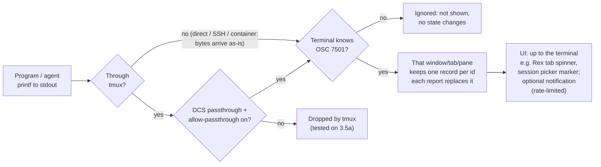
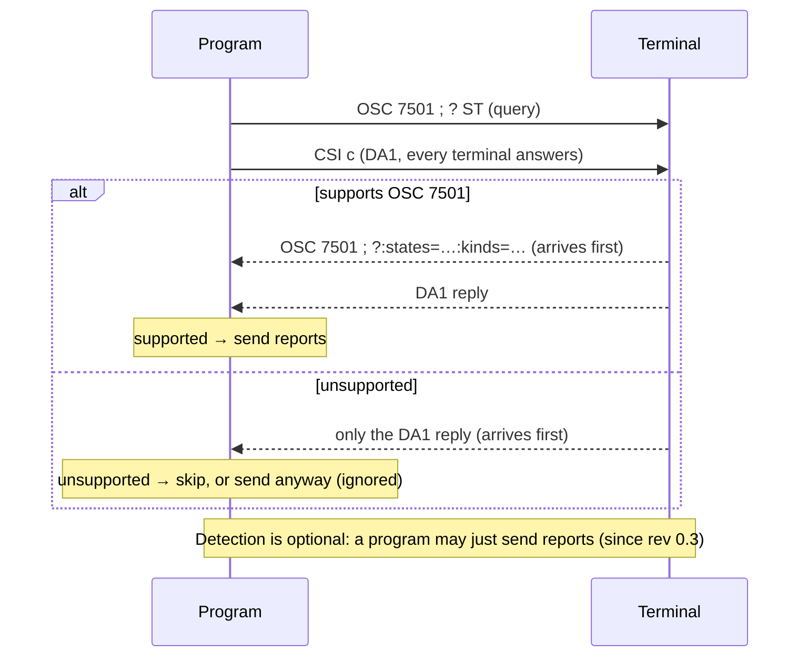
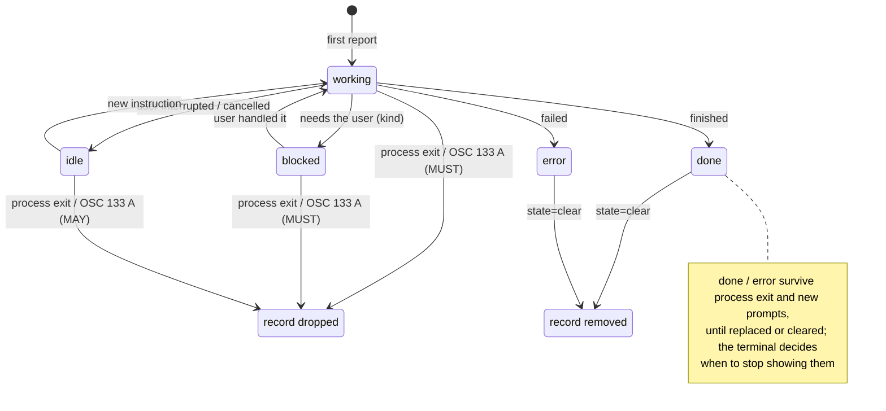

# Awesome OSC 7501

[](https://awesome.re)

> A curated list of resources for [OSC 7501, the "Program Status Protocol"](https://www.superlogical.com/rex/docs/build/program-status): protocol deep dive, reference implementation, ecosystem adoption, practice guides, and a timeline.

[简体中文](README.md) · English (this file)

## If you only read 3 things

<!-- BEGIN GENERATED: top3 (scripts/build.py; edit data/featured.yml instead) -->

- [OSC 7501 规范正文](https://www.superlogical.com/rex/docs/build/program-status) - The only normative text (rev 0.4); the state model and detection sections are enough to write a sender. (Released)
- [Why OSC 7501（博文）](https://mitchellh.com/writing/program-status-osc7501) - The author on why it rides the PTY byte stream instead of an out-of-band socket, and why there is deliberately no heartbeat. (Released)
- [docs/practice.md](docs/practice.md) - Runnable sender/receiver examples from this repo, with real run logs (including tmux passthrough).

<!-- END GENERATED: top3 -->

> Every status carries a primary source and a verification date, and you can re-check
> any row with [scripts/recheck.py](scripts/recheck.py); if you find an error,
> please report it via the issue templates.

**Verification date: <!-- BEGIN GENERATED: verified-at -->2026-10-21<!-- END GENERATED: verified-at --> (Asia/Shanghai, CST).** Every entry traces back to a
primary source (spec, source code, PR, release, or a first-party post). Version
numbers and release dates live only in [docs/support-matrix.md](docs/support-matrix.md)
and [docs/timeline.md](docs/timeline.md); everywhere else we state a status category only. Anything
unverified is marked "unconfirmed".

## Part 1 · Core: the protocol

Details in [docs/deep-dive.md](docs/deep-dive.md) (Chinese).

- **The problem.** Terminals cannot tell what a long-running program (especially an
  AI coding agent) is doing. The author's [launch post](https://x.com/mitchellh/status/2107577887159386152)
  cites 250+ orchestrators each guessing Claude Code's state via
  heuristics, and Herdr making ~10 compatibility changes in 3 months. Proprietary
  out-of-band APIs have an O(N) integration problem and need extra bridging across
  SSH and containers ([blog post](https://mitchellh.com/writing/program-status-osc7501)).
- **What it is.** An OSC escape sequence programs write into the PTY stream to
  report structured status; the terminal decides how to present it.
- **Design principles.** Terminal-native (works over SSH/containers for free),
  presentation-agnostic, no heartbeat, unknown keys ignored (= extension
  mechanism), implementable in one line of POSIX sh, detection optional.
- **State model.** `idle`, `working`, `blocked`, `done`, `error`, plus `clear`
  (deletes a record subtree). Working/blocked records must be dropped on process
  exit or a new shell prompt (OSC 133 A); done/error persist; no keep-alive.
- **Record model.** Each report fully replaces the record for its hierarchical
  `id`; children inherit `app` from the nearest ancestor; RIS clears everything;
  DECSTR does not; alternate-screen switches are unaffected.
- **Detection & fallback.** Send `OSC 7501 ; ?` followed by DA1 (`CSI c`): a DA1
  reply arriving first means unsupported. A supporting terminal must reply with
  `?`, optionally followed by `states=` / `kinds=` lists of what it accepts (rev
  0.4); the spec does not require reusing the request's terminator (Ghostty's
  implementation happens to). A program wanting a state from a later revision
  checks the list and falls back to one that is present, and must ignore pairs
  it does not understand; a reply without lists means exactly the fixed five
  states and three kinds. Detection itself is optional. Terminals that never
  heard of 7501 simply ignore the unknown OSC, so blind sending degrades safely.
  tmux drops unknown OSC; a DCS passthrough with `allow-passthrough on` works
  (verified on tmux 3.5a, see [examples/RUNLOG.md](examples/RUNLOG.md)).
- **Security.** Control characters in decoded `msg`/`title` must be rejected; the
  only bytes a terminal may ever write back is the query reply, which contains
  nothing from any report; show which session a status came from; rate-limit
  notifications. Reports are capped at 4096 bytes.
- **Open questions** in the spec (per-pane multiplexer behavior, records after SSH
  disconnect, Ctrl+Z semantics, id collisions on a shared pty, DA1 race
  requirements for middle layers): see deep-dive §5.

### 30-second version

A program (an AI agent, say) writes a short run of escape bytes to stdout,
starting with `ESC ] 7501` and carrying `key=value` pairs such as
`state=working`. A supporting terminal **does not print those bytes**; it updates
the status record for that window / tab / pane instead. How that status is shown
— a spinner on the tab, a "needs you" hint, a notification — is up to the
terminal: the spec shares state, not presentation (e.g. Rex shows a spinner and
blocked symbols on unfocused tab headers and marks finished or blocked sessions
in its session picker). Terminals that don't know it must ignore unknown OSCs
anyway, so sending blindly is safe.

```sh
printf '\033]7501;state=working:app=demo\033\\'
```

#### 1 · Data flow



The program can also ask first ("do you support this?", optional):



> A supporting terminal must reply starting with `?`, optionally followed by
> `states=` / `kinds=` lists (rev 0.4); DA1 is answered by every terminal, so a
> DA1 reply arriving first means unsupported. The tmux path is this repo's tested
> result on tmux 3.5a (see [examples/RUNLOG.md](examples/RUNLOG.md)); it is not
> part of the spec.

#### 2 · The bytes


The seven segments of the simplest report, byte by byte:

| Bytes | Characters | Meaning |
| --- | --- | --- |
| `1b 5d` | `ESC ]` | OSC (Operating System Command) introducer |
| `37 35 30 31` | `7501` | OSC number |
| `3b` | `;` | separator between number and data |
| `73 74 61 74 65 3d 77 6f 72 6b 69 6e 67` | `state=working` | status key-value pair |
| `3a` | `:` | pair separator |
| `61 70 70 3d 64 65 6d 6f` | `app=demo` | reporter identity |
| `1b 5c` | `ESC \` | ST (String Terminator); BEL (`07`) also works |

#### 3 · State changes



> **Figure note:** This is not a strict state machine. Every report **completely
> replaces** the record for its id, so any state can switch directly to any other
> (including a first report of done/blocked); the diagram only shows common paths
> and the drop rules the spec mandates. `clear` is not a state: it deletes the
> given id and all of its child records — every record of that terminal when no id
> is given — and applies from any state. On user interruption or cancellation the
> program should report `idle`; a program about to exit SHOULD report `done` or
> `error` before exiting, so a record is left for the user.

## Part 2 · Focus: ecosystem and practice

### Featured picks

Sixteen more picks grouped by use case, each with a one-line reason. The full
lists — with every version number and release date — live only in
[docs/support-matrix.md](docs/support-matrix.md); machine-readable exports:
[data/integrations.json](data/integrations.json) and
[data/resources.json](data/resources.json) (articles & discussions).

<!-- BEGIN GENERATED: featured (scripts/build.py; edit data/featured.yml instead) -->

#### Spec and reference implementation

- [program_status.zig](https://github.com/ghostty-org/ghostty/blob/main/src/terminal/osc/parsers/program_status.zig) - Parser written by the spec author; its edge-case tests show what must be rejected more clearly than the prose. (Released)
- [libghostty-vt](https://github.com/ghostty-org/ghostty/pull/14560) - The library holding the reference implementation; only the library has it — the Ghostty app does not show status yet. (Merged, unreleased, see [matrix](docs/support-matrix.md#libghostty-vt))
- [control-codes.page 摘要](https://control-codes.page/proposals/osc-7501/) - Neutral third-party summary for quick field lookup. (Released)

#### Receivers

- [Kitty](https://github.com/kovidgoyal/kitty/issues/10638) - kitty's author reviewed the spec (prompting rev 0.4), then implemented it on master (unreleased) with an id limit of 263 instead of the spec's 128. (Merged, unreleased, see [matrix](docs/support-matrix.md#kitty))
- [cmux](https://github.com/manaflow-ai/cmux/pull/18742) - The spec leaves per-pane records undefined for multiplexers; cmux shows one workable answer. (Released, see [matrix](docs/support-matrix.md#cmux))
- [termio](https://github.com/termio-sh/termio/pull/713) - A daemon produces status shared across Mac, phone and CLI. (Released, see [matrix](docs/support-matrix.md#termio))
- [tmux](https://github.com/tmux/tmux/issues/5713) - The key dissent: the maintainer considers pane titles + OSC 9 + OSC 133 enough and closed the issue; inside tmux you need DCS passthrough. (Unsupported, see [matrix](docs/support-matrix.md#tmux))

#### Senders

- [Claude Code](https://github.com/anthropics/claude-code/releases/tag/v2.1.295) - Support is stated in its CHANGELOG; the spec author relays that Anthropic tested it with Rex. (Released, see [matrix](docs/support-matrix.md#claude-code))
- [Codex CLI（openai/codex）](https://github.com/openai/codex/pull/52725) - Shipped since rust-v0.163.0; usable to test a receiver. (Released, see [matrix](docs/support-matrix.md#codex-cli))
- [pi（earendil-works/pi）](https://github.com/earendil-works/pi/releases/tag/v1.1.0) - Only sends after the terminal answers the query and documents that tmux/screen do not forward it. (Released, see [matrix](docs/support-matrix.md#pi))
- [tuist](https://github.com/tuist/tuist/pull/13956) - Not just for AI: reports blocked (kind=auth) while waiting for browser login. (Merged, unreleased, see [matrix](docs/support-matrix.md#tuist))
- [Hugo](https://github.com/gohugoio/hugo/pull/15428) - Emits it alongside OSC 9;4 progress; shows how both coexist. (Released, see [matrix](docs/support-matrix.md#hugo))
- [firebase-tools](https://github.com/firebase/firebase-tools/pull/11245) - Counter-example: maintainers found wrapping every call site by hand unmaintainable; two attempts were closed. (Closed, see [matrix](docs/support-matrix.md#firebase-tools))

#### Libraries

- [Bubble Tea](https://github.com/charmbracelet/bubbletea/releases/tag/v2.1.0) - Implemented at the Go TUI framework layer; downstream apps get it by upgrading. (Released, see [matrix](docs/support-matrix.md#bubble-tea))
- [OpenTUI](https://github.com/anomalyco/opentui/pull/1657) - TypeScript TUI library exposing setProgramStatus(); opencode adopted it through this. (Released, see [matrix](docs/support-matrix.md#opentui))

#### Discussion

- [OOM 残留讨论](https://x.com/shahidcodes/status/2107995544065081475) - A real stale-record case after an OOM kill over SSH, and why the author still refuses heartbeats. (Released)

<!-- END GENERATED: featured -->

### Why integrate (summary)

Full analysis with sources in [docs/why-integrate.md](docs/why-integrate.md)
(Chinese).

1. **Stop screen-scraping for state** — 250+ orchestrators each ran their own
   heuristics; Herdr made ~10 compatibility changes in 3 months
   ([launch tweet](https://x.com/mitchellh/status/2107577887159386152)).
2. **"Needs you" becomes visible** — once the user has switched away, the
   terminal or workbench can surface "this agent is waiting for you"
   ([docker-agent #4544](https://github.com/docker/docker-agent/pull/4544),
   [tuist #13956](https://github.com/tuist/tuist/pull/13956)).
3. **Multi-session / multi-agent management** — sidebars sorted by urgency, a
   unified inbox, visible even from a phone
   ([cmux docs](https://github.com/manaflow-ai/cmux/blob/main/docs/program-status.md),
   [termio #713](https://github.com/termio-sh/termio/pull/713)).
4. **Cross-SSH/containers at zero integration cost** — the PTY byte stream
   passes through natively; out-of-band sockets need extra bridging
   ([blog post](https://mitchellh.com/writing/program-status-osc7501)).
5. **Libraries implement once, every downstream app gains** — Bubble Tea,
   SwiftTerm, libghostty-vt went first
   ([Bubble Tea](https://github.com/charmbracelet/bubbletea) release notes, see
   the matrix; network effects are inferred).
6. **Interop with harnesses** — 7501 first, heuristics as a fallback layer
   ([claude-fleet #2597](https://github.com/verkyyi/claude-fleet/pull/2597)).
7. **Low implementation cost** — every PoC is under a dozen lines; one POSIX sh
   function is enough ([blog post](https://mitchellh.com/writing/program-status-osc7501)).

### Overview

<!-- BEGIN GENERATED: status-counts -->

Status counts (121 tracked entries; methodology in the [support matrix](docs/support-matrix.md); latest verified 2026-10-21):

| Status | Count |
| --- | --- |
| Released | 51 |
| Implemented (self-reported) | 1 |
| Merged, unreleased | 26 |
| In development | 17 |
| Announced | 3 |
| Closed | 6 |
| Unsupported | 14 |
| Unconfirmed | 3 |
| Total | 121 |

<!-- END GENERATED: status-counts -->

### Common misconceptions

- Misconception: "Ghostty already supports 7501" → Fact: only the libghostty-vt
  library has it (merged, not in tag v1.3.1); the Ghostty app itself ignores
  reports ([PR #14560](https://github.com/ghostty-org/ghostty/pull/14560),
  [stream_handler.zig](https://github.com/ghostty-org/ghostty/blob/main/src/termio/stream_handler.zig)).
- Misconception: "You can just send inside tmux" → Fact: tmux drops unknown OSC
  (verified on 3.5a in this repo); you need DCS passthrough +
  `allow-passthrough on`; upstream [#5713](https://github.com/tmux/tmux/issues/5713)
  is closed, with no native support ([examples/RUNLOG.md](examples/RUNLOG.md)).
- Misconception: "You must re-send periodically to keep records alive" → Fact:
  the spec mandates no heartbeat and terminals must not require re-sends; the
  author has said the omission is deliberate
  ([spec](https://www.superlogical.com/rex/docs/build/program-status),
  [author reply](https://x.com/mitchellh/status/2107997330238795818)).
- Misconception: "Only send the keys that changed" → Fact: each report fully
  replaces the record for its id; missing keys disappear, so always include
  `app` ([spec](https://www.superlogical.com/rex/docs/build/program-status)).
- Misconception: "done disappears when the process exits" → Fact: done/error
  survive process exit and new prompts until replaced or cleared; only
  working/blocked must be dropped
  ([spec](https://www.superlogical.com/rex/docs/build/program-status)).
- Misconception: "Sending without detection garbles unsupported terminals" →
  Fact: terminals must ignore unknown OSC per the spec, so blind sending
  degrades safely; detection has been optional since rev 0.3
  ([spec](https://www.superlogical.com/rex/docs/build/program-status)).
- Misconception: "kitty doesn't support it" → Fact: kitty master has it
  (unreleased), with an id limit of 263
  ([#10638](https://github.com/kovidgoyal/kitty/issues/10638),
  [commit](https://github.com/kovidgoyal/kitty/commit/0e1b7f4812bf297639999a362672c4271e42ed0c)).

### Examples

Runnable sender and receiver examples (POSIX sh helpers, byte-level demo, command
wrapper, feature detection, a fully validating Python incremental parser with <!-- BEGIN GENERATED: test-count -->49<!-- END GENERATED: test-count -->
tests, and a tmux passthrough experiment) live in [examples/](examples/); real
recorded output in [examples/RUNLOG.md](examples/RUNLOG.md). The how-to guide is
[docs/practice.md](docs/practice.md) (Chinese).

### Gaps to fill (contribute)

See [deep-dive §5](docs/deep-dive.md#5-时间--空间--变量--反--空) (Chinese) for
the full list. The highest-value items right now:

1. A compliance test suite — the spec defines no reference tests.
2. A per-pane record model and reporting convention for multiplexers
   (tmux/zellij side).
3. Mapping/migration tooling and docs from OSC 9;4 to 7501.
4. Small sender libraries per language (Go/Rust/TS…) and "id planning" best
   practices.
5. Follow up on the id length limit (the spec still says 128; kitty implemented
   263 = 8×32+7 — implementations and spec text now disagree).

## Contributing

See [CONTRIBUTING.md](CONTRIBUTING.md). Primary sources only; every status claim
needs a link and a verification date; versions go into the matrix/timeline only.
The data contract for agents and maintainers (data flow, field glossary,
status/evidence enums, verification and AI policy) is [AGENTS.md](AGENTS.md).

## License

[CC0-1.0](LICENSE).

---

## Disclaimer

This repository uses AI to help with research, analysis and diagrams. A human edits, corrects and organizes the content in depth. It is maintained mainly for my own technical research and practice, and is provided for reference only.

Data and status may lag behind the original sources. Please check the linked sources and use your own judgment before relying on them.

If any content infringes your rights, please open an [issue](https://github.com/hyeebeen/awesome-osc7501/issues) and I will review and remove it promptly.
