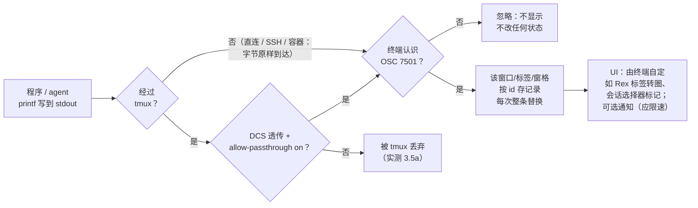
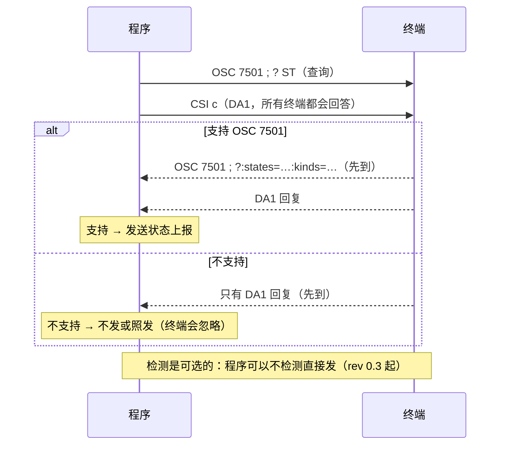
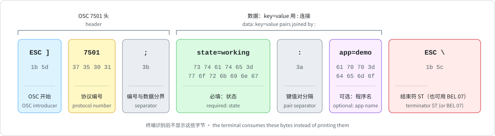
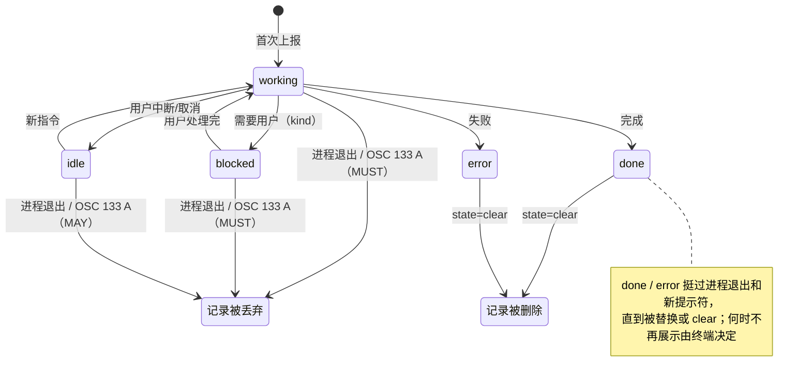

# Awesome OSC 7501

[](https://awesome.re)

> 精选的 [OSC 7501「Program Status Protocol」](https://www.superlogical.com/rex/docs/build/program-status) 资源清单：协议深度解读、参考实现、生态集成方、实践用法与时间线。

[English](README.en.md) · 简体中文（本文件）

## 只看 3 条

<!-- BEGIN GENERATED: top3 (scripts/build.py; edit data/featured.yml instead) -->

- [OSC 7501 规范正文](https://www.superlogical.com/rex/docs/build/program-status) - 唯一权威规范（现行 rev 0.4）；先读「状态模型」「检测」两节，就够写出一个发送端。（已发布）
- [Why OSC 7501（博文）](https://mitchellh.com/writing/program-status-osc7501) - 作者自己讲为什么走 PTY 字节流而不是带外 socket、为什么故意不做心跳；理解设计取舍最快的入口。（已发布）
- [docs/practice.md](docs/practice.md) - 本仓库可运行的发送端/接收端示例与实测记录（含 tmux 透传），读完能直接动手。

<!-- END GENERATED: top3 -->

> 每条状态都附一手来源与核实日期，可用
> [scripts/recheck.py](scripts/recheck.py) 复核；如发现错误请用 issue 模板报告。

**核实日期：<!-- BEGIN GENERATED: verified-at -->2026-10-21<!-- END GENERATED: verified-at -->（Asia/Shanghai，CST）。** 本清单只收录可回溯到一手源
（规范/源码/PR/release/作者帖子）的事实；版本号与发布日期集中在
[docs/support-matrix.md](docs/support-matrix.md) 与 [docs/timeline.md](docs/timeline.md)，
正文一律只写状态类别。未核实的内容标「未确认」。

## 目录

- [第一部分 · 核心：协议](#第一部分--核心协议)
  - [要解决的问题](#要解决的问题)
  - [设计原则](#设计原则)
  - [30 秒看懂](#30-秒看懂)
  - [状态模型](#状态模型)
  - [记录模型](#记录模型)
  - [兼容检测与降级](#兼容检测与降级)
  - [安全边界](#安全边界)
  - [规范未说清之处](#规范未说清之处)
- [第二部分 · 重点：生态与实践](#第二部分--重点生态与实践)
  - [精选](#精选)
  - [为什么大家要集成（摘要）](#为什么大家要集成摘要)
  - [支持概览](#支持概览)
  - [常见误解](#常见误解)
  - [示例](#示例)
  - [空白清单（可贡献）](#空白清单可贡献)
- [贡献](#贡献) · [许可](#许可)

---

## 第一部分 · 核心：协议

细节与逐字节拆解见 [docs/deep-dive.md](docs/deep-dive.md)。

### 要解决的问题

终端里长跑的程序（尤其是 AI coding agent）处于什么状态，终端本身无从得知：

1. **启发式读屏不可靠**：作者 Mitchell Hashimoto 发布
   [推文](https://x.com/mitchellh/status/2107577887159386152) 称，他发现 250+ 个
   agent 编排器各自用启发式去猜 Claude Code 是否在干活；
   Herdr 因此在 3 个月里改了约 10 次兼容性。
2. **专有带外 API 有 O(N) 集成问题**：每个程序对每个 inbox/工作台单独对接是
   O(N) 的，而且 socket 等带外通道跨 SSH、容器时需要额外桥接（[博文](https://mitchellh.com/writing/program-status-osc7501)）。

OSC 7501 让程序通过**终端转义序列**（本来就走的 PTY 字节流）把结构化状态
报告给终端，终端再以自己的方式呈现（标签、侧栏、通知、统一 inbox……）。

> 想看完整的「为什么」、社区声音和前景分析：[docs/why.md](docs/why.md)。

### 设计原则

| 原则 | 含义 |
| --- | --- |
| 终端原生 | 走 PTY 里的 OSC 序列，天然跨 SSH 与容器，无需带外通道 |
| 呈现无关 | 协议只描述状态语义，如何展示完全由接收端决定 |
| 无心跳 | 报告即状态快照，终端不得要求程序重发保活 |
| 未知 key 忽略 | 即扩展机制：新增键不会让旧接收端丢整条报告 |
| 零依赖可实现 | POSIX sh 一行 `printf` 即可发送；接收端一个函数即可解析 |
| 检测可选 | 不检测直接发也无害（未知 OSC 被终端忽略），检测可换取更好体验 |

### 30 秒看懂

程序（比如一个 AI agent）往 stdout 写一小串以 `ESC ] 7501` 开头的转义字节，内容是
`state=working` 这样的键值对。支持它的终端**不会把这串字节显示出来**，而是更新这个
窗口 / 标签 / 窗格的状态记录；至于怎么展示——标签上转圈、提示「需要你」、弹通知——由终端
自己决定，规范只共享状态、不规定展示（例如 Rex 在未聚焦标签上显示转圈和 blocked 符号，
在会话选择器里标出已完成或被阻塞的会话）。不认识它的终端按规范本来就必须忽略未知
OSC，所以直接发也是安全的。

```sh
printf '\033]7501;state=working:app=demo\033\\'
```

#### ① 数据怎么流动



程序也可以先问一句「你支持吗」（可选）：



> 支持的终端必须回复以 `?` 开头的应答，之后可选跟 `states=` / `kinds=` 支持
> 列表（rev 0.4）；DA1 是所有终端都会回答的，所以 DA1 回复先到就说明不支持。
> tmux 一路是本仓库在 tmux 3.5a 上的实测结果（见
> [examples/RUNLOG.md](examples/RUNLOG.md)），不是规范内容。

#### ② 这串字节长什么样



| 字节 | 字符 | 含义 |
| --- | --- | --- |
| `1b 5d` | `ESC ]` | OSC（Operating System Command）引入 |
| `37 35 30 31` | `7501` | OSC 编号 |
| `3b` | `;` | 编号与数据分界 |
| `73 74 61 74 65 3d 77 6f 72 6b 69 6e 67` | `state=working` | 状态键值对 |
| `3a` | `:` | pair 分隔符 |
| `61 70 70 3d 64 65 6d 6f` | `app=demo` | 报告者标识 |
| `1b 5c` | `ESC \` | ST（String Terminator）；也可用 BEL（`07`）结尾 |

#### ③ 状态怎么变



> **图注：** 这不是严格的状态机。每次上报都**整条替换**该 id 的记录，任何状态都可以
> 直接换成任何其他状态（包括首次上报就是 done/blocked 等）；图里只画了常见路径和规范
> 规定的丢弃规则。`clear` 不是状态：它删除指定 id 及其所有子记录，不带 id 时清空该终端
> 全部记录，对任何状态都适用。用户中断或取消时程序应报 `idle`；即将退出的程序 SHOULD
> 在退出前报 `done` 或 `error`，好留下记录给用户看。

### 状态模型

| state | 语义 | 专属可选键 | 生命周期（终端侧） |
| --- | --- | --- | --- |
| `idle` | 空闲/取消 | — | 直到被替换或清除；进程退出/新提示符时可丢弃（MAY） |
| `working` | 正在工作中 | `progress`（0–100，缺省=不确定） | 进程退出或新提示符（OSC 133 A）时必须丢弃 |
| `blocked` | 等待外部输入 | `kind`（permission/question/auth）、`progress` | 同上，必须丢弃 |
| `done` | 成功完成 | — | 保留 |
| `error` | 失败 | — | 保留 |
| `clear` | 删除记录 | `id` | 删除该 id 及其所有子记录；无 id 时清空该终端全部记录 |

### 记录模型

- 每条报告**完整替换**其 id 对应的记录（缺的键就从记录里消失，所以每次都要重发 `app`）。
- `id` 是层级路径（`a/b/c`，最深 8 层）；子记录的 `app` 从最近祖先继承。
- RIS 全复位清除所有记录；DECSTR 软复位不清；主/备用屏切换无影响。
- 每终端记录上限 256（终端可设更低，但至少支持 64），超出时淘汰最久未更新的。

### 兼容检测与降级

- 程序发 `ESC ] 7501 ; ? ESC \` 查询，支持的终端必须回复 `?`，之后可选跟
  `states=` / `kinds=` 支持列表；可紧跟 DA1（`CSI c`）作为「不支持」的哨兵——
  DA1 回复先到即视为不支持。规范不要求回复复用请求的终止符（Ghostty 的实现
  恰好用了相同终止符）。检测本身是可选的。
- 支持列表怎么用（rev 0.4）：想用后续版本新增 state 的程序先查 `states=`，没有
  就回退到列表里有的状态；回复里不认识的键值对必须忽略；回复不带列表时，按
  固定的 5 个 state、3 个 kind 算（规范承诺以后版本也不变）。
- 不支持 7501 的终端本来就会忽略未知 OSC，所以「盲发」安全降级为零。
- tmux 等会丢弃未知 OSC 的多路复用器需要 DCS passthrough（`ESC P tmux; … ESC \`，
  内部 ESC 加倍）并开启 `allow-passthrough`；本仓库在 tmux 3.5a 上实测确认
  （见 [examples/RUNLOG.md](examples/RUNLOG.md)）。

### 安全边界

- `msg`/`title` 解码后含控制字符必须拒收、不得当标记解析。
- 在协议界面之外展示时，SHOULD 解除 bidi 方向覆盖等不可见格式字符。
- 终端唯一允许回写的是检测回复，其中不含任何报告内容（防注入）。
- 展示 SHOULD 标明状态来自哪个终端/会话（防冒充）；外部效果（通知、声音）SHOULD 限速。
- 整条报告上限 4096 字节，`msg`/`title`/`id`/`app` 各有限长（见 deep-dive 限制表）。

### 规范未说清之处

详见 [deep-dive §5 空](docs/deep-dive.md#5-时间--空间--变量--反--空)，摘要：

1. 多路复用器如何按 pane 保存并上报记录（规范未定义，cmux 等自行设计）。
2. SSH 断开后远端残留记录如何处理。
3. 挂起（Ctrl+Z）期间的语义（实践已在 Bubble Tea、para-code 暴露）。
4. 多个程序共用一个 pty 时的 id 冲突。
5. DA1 竞态对中间层（多路复用器）的时序要求（termio 已被迫自行约定）。

---

## 第二部分 · 重点：生态与实践

### 精选

「只看 3 条」之外，再按场景挑 16 条，每条一句话说明为什么值得看。完整清单
（含全部版本号与发布日期）只住在 [docs/support-matrix.md](docs/support-matrix.md)；
机器可读导出见 [data/integrations.json](data/integrations.json) 与
[data/resources.json](data/resources.json)（文章与讨论类条目）。

<!-- BEGIN GENERATED: featured (scripts/build.py; edit data/featured.yml instead) -->

#### 规范与参考实现

- [program_status.zig](https://github.com/ghostty-org/ghostty/blob/main/src/terminal/osc/parsers/program_status.zig) - 规范作者本人写的解析器，边界测试比规范更清楚地说明「什么必须拒收」。（已发布）
- [libghostty-vt](https://github.com/ghostty-org/ghostty/pull/14560) - 参考实现所在的库；注意只是库已合并，Ghostty 应用本身还不显示状态。（已合并未发版，见 [矩阵](docs/support-matrix.md#libghostty-vt)）
- [control-codes.page 摘要](https://control-codes.page/proposals/osc-7501/) - 第三方中立摘要，适合快速对照字段。（已发布）

#### 接收端

- [Kitty](https://github.com/kovidgoyal/kitty/issues/10638) - kitty 作者先评审规范（促成 rev 0.4），随后在 master 实现（未发版）；id 上限用 263 而非规范的 128，实现与规范在这一点上已不一致。（已合并未发版，见 [矩阵](docs/support-matrix.md#kitty)）
- [cmux](https://github.com/manaflow-ai/cmux/pull/18742) - 规范没定义多路复用器该怎么按 pane 存记录，cmux 给出了一种可参考的做法（按紧急度排序侧栏）。（已发布，见 [矩阵](docs/support-matrix.md#cmux)）
- [termio](https://github.com/termio-sh/termio/pull/713) - 由 daemon 产生状态并在 Mac、手机、CLI 间共享，展示了状态离开终端窗口后的用法。（已发布，见 [矩阵](docs/support-matrix.md#termio)）
- [tmux](https://github.com/tmux/tmux/issues/5713) - 最重要的反对意见：维护者认为窗格标题 + OSC 9 + OSC 133 已够用，并关闭了 issue；在 tmux 里要靠 DCS 透传。（未支持，见 [矩阵](docs/support-matrix.md#tmux)）

#### 发送端

- [Claude Code](https://github.com/anthropics/claude-code/releases/tag/v2.1.295) - CHANGELOG 明确写入 Program Status Protocol 支持；规范作者转述 Anthropic 用 Rex 验证过。（已发布，见 [矩阵](docs/support-matrix.md#claude-code)）
- [Codex CLI（openai/codex）](https://github.com/openai/codex/pull/52725) - 从 rust-v0.163.0 起正式发布，可以拿来实测接收端。（已发布，见 [矩阵](docs/support-matrix.md#codex-cli)）
- [pi（earendil-works/pi）](https://github.com/earendil-works/pi/releases/tag/v1.1.0) - 只在终端应答查询后才发送，并写明 tmux/screen 不转发——「先检测再发」的样板。（已发布，见 [矩阵](docs/support-matrix.md#pi)）
- [tuist](https://github.com/tuist/tuist/pull/13956) - 非 AI 的 CLI 也用得上：浏览器登录等待时报 blocked（kind=auth）。（已合并未发版，见 [矩阵](docs/support-matrix.md#tuist)）
- [Hugo](https://github.com/gohugoio/hugo/pull/15428) - 与 OSC 9;4 进度条并存的实现，适合看两种协议怎么同时发。（已发布，见 [矩阵](docs/support-matrix.md#hugo)）
- [firebase-tools](https://github.com/firebase/firebase-tools/pull/11245) - 反面经验：维护者认为在每个调用点手工包裹难以维护，两次实现被关闭。（已关闭，见 [矩阵](docs/support-matrix.md#firebase-tools)）

#### 库

- [Bubble Tea](https://github.com/charmbracelet/bubbletea/releases/tag/v2.1.0) - Go TUI 框架层实现，下游程序升级即获得能力。（已发布，见 [矩阵](docs/support-matrix.md#bubble-tea)）
- [OpenTUI](https://github.com/anomalyco/opentui/pull/1657) - TypeScript TUI 库提供 setProgramStatus()，opencode 借它接入。（已发布，见 [矩阵](docs/support-matrix.md#opentui)）

#### 讨论

- [OOM 残留讨论](https://x.com/shahidcodes/status/2107995544065081475) - 远端 agent 被 OOM kill 后 blocked 记录悬挂的真实问题，以及作者为何仍不做心跳。（已发布）

<!-- END GENERATED: featured -->

### 为什么大家要集成（摘要）

完整分析见 [docs/why-integrate.md](docs/why-integrate.md)。

1. **不再靠读屏猜状态**——250+ 编排器各自启发式、Herdr 3 个月约 10 次兼容改动（[发布推文](https://x.com/mitchellh/status/2107577887159386152)）。
2. **「需要你」时能被感知**——用户切走后，终端/工作台才能浮现「这个 agent 在等你」（[docker-agent #4544](https://github.com/docker/docker-agent/pull/4544)、[tuist #13956](https://github.com/tuist/tuist/pull/13956)）。
3. **多会话/多 agent 管理**——侧栏按紧急度排序、统一 inbox、手机上也看得到（[cmux](https://github.com/manaflow-ai/cmux/blob/main/docs/program-status.md)、[termio #713](https://github.com/termio-sh/termio/pull/713)）。
4. **跨 SSH/容器、零集成成本**——PTY 字节流天然穿透，带外 socket 要额外桥接（[博文](https://mitchellh.com/writing/program-status-osc7501)）。
5. **库层一次实现、下游全部获得**——Bubble Tea、SwiftTerm、libghostty-vt 等库先行，用库的程序与终端免费获得能力（[Bubble Tea](https://github.com/charmbracelet/bubbletea) 发布说明，见矩阵；网络效应为推断）。
6. **与 harness 互操作**——7501 优先、启发式补位的分层状态来源（[claude-fleet #2597](https://github.com/verkyyi/claude-fleet/pull/2597)）。
7. **实现成本低**——每个 PoC 不超过十几行，POSIX sh 一个函数即可（[博文](https://mitchellh.com/writing/program-status-osc7501)）。

### 支持概览

<!-- BEGIN GENERATED: status-counts -->

状态类别统计（121 个条目，统计口径见 [docs/support-matrix.md](docs/support-matrix.md)；最近核实 2026-10-21）：

| 状态 | 数量 |
| --- | --- |
| 已发布 | 51 |
| 已实现（自述） | 1 |
| 已合并未发版 | 26 |
| 开发中 | 17 |
| 仅宣布 | 3 |
| 已关闭 | 6 |
| 未支持 | 14 |
| 未确认 | 3 |
| 合计 | 121 |

<!-- END GENERATED: status-counts -->

### 常见误解

- 误解：「Ghostty 已经支持 7501」→ 事实：只有 libghostty-vt 库合并了（未进
  tag v1.3.1），Ghostty 应用侧忽略报告（[PR #14560](https://github.com/ghostty-org/ghostty/pull/14560)、
  [stream_handler.zig](https://github.com/ghostty-org/ghostty/blob/main/src/termio/stream_handler.zig)）。
- 误解：「在 tmux 里直接发就行」→ 事实：tmux 丢弃未知 OSC（本仓库 3.5a 实测），
  需 DCS passthrough + `allow-passthrough on`；上游 [#5713](https://github.com/tmux/tmux/issues/5713)
  已关闭、不做原生支持（[examples/RUNLOG.md](examples/RUNLOG.md)）。
- 误解：「需要定时重发保活」→ 事实：规范规定无心跳，终端不得要求重发；作者在
  讨论中明确故意不做（[规范](https://www.superlogical.com/rex/docs/build/program-status)、
  [作者回复](https://x.com/mitchellh/status/2107997330238795818)）。
- 误解：「每次只发变化的键」→ 事实：每条报告整条替换该 id 的记录，缺的键会
  消失，所以每次都要带 `app`（[规范](https://www.superlogical.com/rex/docs/build/program-status)）。
- 误解：「done 会随进程退出消失」→ 事实：done/error 会挺过进程退出和新提示符，
  直到被替换或 clear；working/blocked 才必须丢弃
  （[规范](https://www.superlogical.com/rex/docs/build/program-status)）。
- 误解：「不检测就发会在不支持的终端上乱码」→ 事实：未知 OSC 按规范必须被忽略，
  不检测直接发也无害；检测自 rev 0.3 起是可选的
  （[规范](https://www.superlogical.com/rex/docs/build/program-status)）。
- 误解：「kitty 不支持」→ 事实：kitty master 已实现（尚未发版），id 上限用
  263（[#10638](https://github.com/kovidgoyal/kitty/issues/10638)、
  [commit 0e1b7f4](https://github.com/kovidgoyal/kitty/commit/0e1b7f4812bf297639999a362672c4271e42ed0c)）。

### 示例

本仓库 [examples/](examples/) 提供可运行的发送端与接收端最小实现，全部在
Linux + tmux 3.5a 上实际运行过（真实输出见 [examples/RUNLOG.md](examples/RUNLOG.md)）：
POSIX sh 函数库、字节级演示、命令包装器、特性检测、带完整校验的 Python
增量解析器（<!-- BEGIN GENERATED: test-count -->49<!-- END GENERATED: test-count --> 个单测）、tmux DCS passthrough 实验。实践指南见
[docs/practice.md](docs/practice.md)。

### 空白清单（可贡献）

详见 [deep-dive §5 空](docs/deep-dive.md#5-时间--空间--变量--反--空)。当前最值得做的：

1. 一致性测试套件（compliance test suite）——规范没有定义参考测试。
2. 多路复用器的 per-pane 记录模型与上报约定（tmux/zellij 侧）。
3. OSC 9;4 → 7501 的映射/迁移工具与文档。
4. 各语言的小型发送端库（Go/Rust/TS…）与「id 规划」最佳实践。
5. 跟进 id 长度上限问题（规范仍写 128；kitty 已按 8×32+7=263 实现，两者不一致，待规范表态）。

---

## 贡献

见 [CONTRIBUTING.md](CONTRIBUTING.md)：只收一手源可核实条目；状态必须附来源
链接与核实日期；版本号只进矩阵/时间线；未核实的一律不收。面向 agent 与
维护者的数据契约（数据流、字段表、状态/证据枚举、核验方法、AI 贡献政策）见
[AGENTS.md](AGENTS.md)。

## 许可

清单与文档内容以 [CC0-1.0](LICENSE) 发布。

---

## 声明

本仓库在资料检索、信息分析和图表绘制中使用了 AI 辅助，由人工编辑校正并深度梳理。它主要服务于我个人的技术研究与实践，内容仅供参考。

文中的数据和状态可能存在延迟，请以原始出处为准，谨慎判断后再使用。

如有内容涉及侵权，请在 [Issues](https://github.com/hyeebeen/awesome-osc7501/issues) 留言，我会尽快核实并删除。
