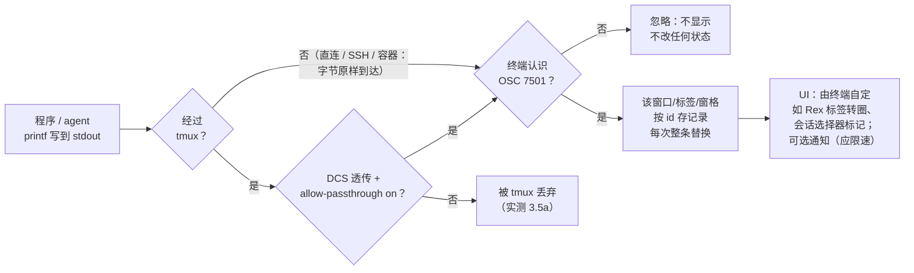
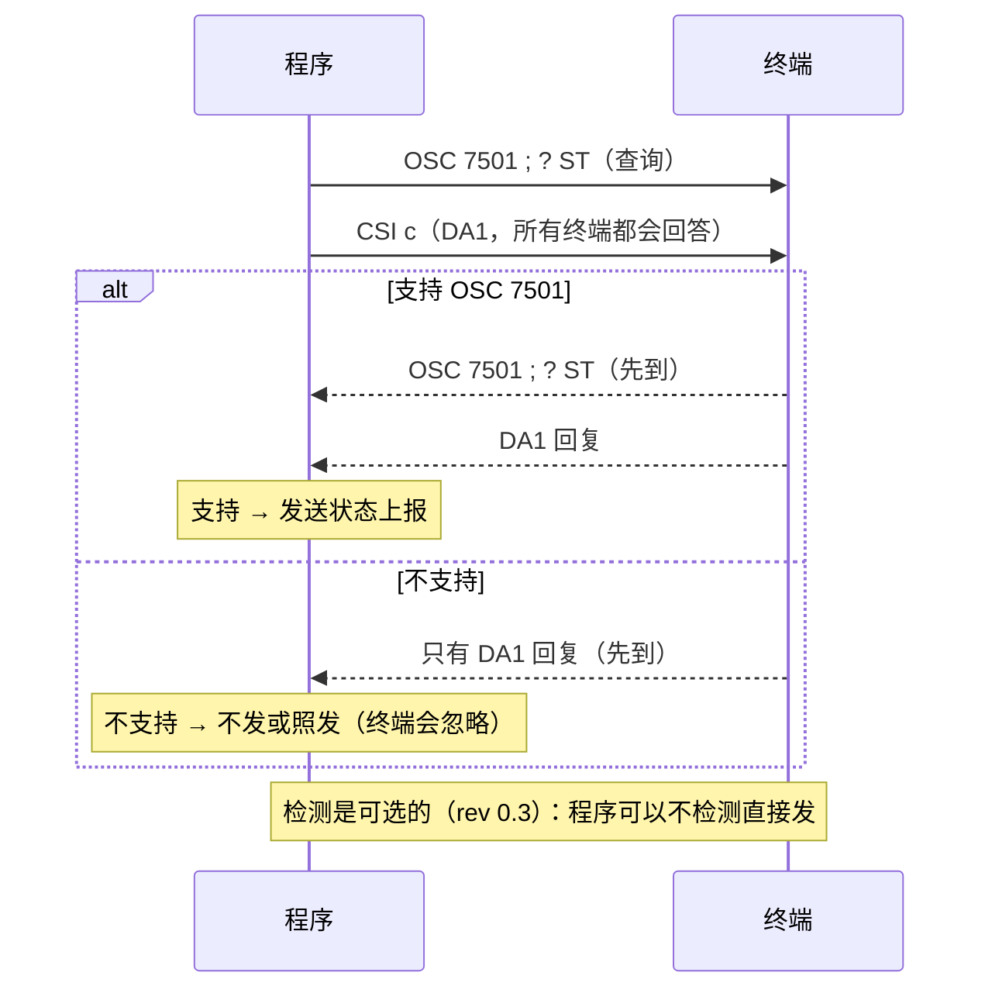
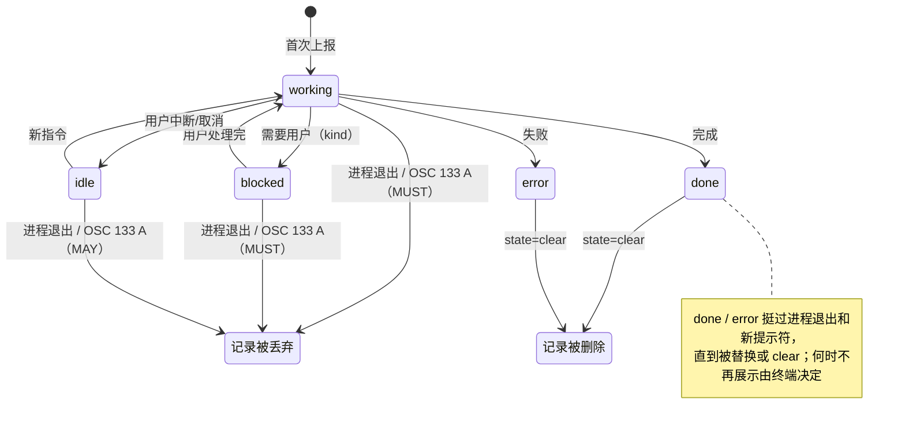

# Awesome OSC 7501

[](https://awesome.re)

> 精选的 [OSC 7501「Program Status Protocol」](https://www.superlogical.com/rex/docs/build/program-status) 资源清单：协议深度解读、参考实现、生态集成方、实践用法与时间线。

[English](README.en.md) · 简体中文（本文件）

**核实日期：2026-10-09（Asia/Shanghai，CST）。** 本清单只收录可回溯到一手源
（规范/源码/PR/release/作者帖子）的事实；版本号与发布日期集中在
[docs/support-matrix.md](docs/support-matrix.md) 与 [docs/timeline.md](docs/timeline.md)，
正文一律只写状态类别。未核实的内容标「未确认」。

## 目录

- [第一部分 · 核心：协议](#第一部分--核心协议)
  - [要解决的问题](#要解决的问题)
  - [设计原则](#设计原则)
  - [30 秒看懂](#30-秒看懂)
  - [状态模型](#状态模型)
  - [记录模型](#记录模型)
  - [兼容检测与降级](#兼容检测与降级)
  - [安全边界](#安全边界)
  - [规范未说清之处](#规范未说清之处)
- [第二部分 · 重点：生态与实践](#第二部分--重点生态与实践)
  - [精选清单](#精选清单)
  - [为什么大家要集成（摘要）](#为什么大家要集成摘要)
  - [支持概览](#支持概览)
  - [示例](#示例)
  - [空白清单（可贡献）](#空白清单可贡献)
- [贡献](#贡献) · [许可](#许可)

---

## 第一部分 · 核心：协议

细节与逐字节拆解见 [docs/deep-dive.md](docs/deep-dive.md)。

### 要解决的问题

终端里长跑的程序（尤其是 AI coding agent）处于什么状态，终端本身无从得知：

1. **启发式读屏不可靠**：作者 Mitchell Hashimoto 发布
   [推文](https://x.com/mitchellh/status/2107577887159386152) 称，他发现 250+ 个
   agent 编排器各自用启发式去猜 Claude Code 是否在干活；
   Herdr 因此在 3 个月里改了约 10 次兼容性。
2. **专有带外 API 有 O(N) 集成问题**：每个程序对每个 inbox/工作台单独对接是
   O(N) 的，而且 socket 等带外通道跨 SSH、容器时需要额外桥接（[博文](https://mitchellh.com/writing/program-status-osc7501)）。

OSC 7501 让程序通过**终端转义序列**（本来就走的 PTY 字节流）把结构化状态
报告给终端，终端再以自己的方式呈现（标签、侧栏、通知、统一 inbox……）。

### 设计原则

| 原则 | 含义 |
| --- | --- |
| 终端原生 | 走 PTY 里的 OSC 序列，天然跨 SSH 与容器，无需带外通道 |
| 呈现无关 | 协议只描述状态语义，如何展示完全由接收端决定 |
| 无心跳 | 报告即状态快照，终端不得要求程序重发保活 |
| 未知 key 忽略 | 即扩展机制：新增键不会让旧接收端丢整条报告 |
| 零依赖可实现 | POSIX sh 一行 `printf` 即可发送；接收端一个函数即可解析 |
| 检测可选 | 不检测直接发也无害（未知 OSC 被终端忽略），检测可换取更好体验 |

### 30 秒看懂

程序（比如一个 AI agent）往 stdout 写一小串以 `ESC ] 7501` 开头的转义字节，内容是
`state=working` 这样的键值对。支持它的终端**不会把这串字节显示出来**，而是更新这个
窗口 / 标签 / 窗格的状态记录；至于怎么展示——标签上转圈、提示「需要你」、弹通知——由终端
自己决定，规范只共享状态、不规定展示（例如 Rex 在未聚焦标签上显示转圈和 blocked 符号，
在会话选择器里标出已完成或被阻塞的会话）。不认识它的终端按规范本来就必须忽略未知
OSC，所以直接发也是安全的。

```sh
printf '\033]7501;state=working:app=demo\033\\'
```

#### ① 数据怎么流动



程序也可以先问一句「你支持吗」（可选）：



> 规范要求支持的终端原样回复 `OSC 7501 ; ?`；DA1 是所有终端都会回答的，所以 DA1
> 回复先到就说明不支持。tmux 一路是本仓库在 tmux 3.5a 上的实测结果（见
> [examples/RUNLOG.md](examples/RUNLOG.md)），不是规范内容。

#### ② 这串字节长什么样


| 字节 | 字符 | 含义 |
| --- | --- | --- |
| `1b 5d` | `ESC ]` | OSC（Operating System Command）引入 |
| `37 35 30 31` | `7501` | OSC 编号 |
| `3b` | `;` | 编号与数据分界 |
| `73 74 61 74 65 3d 77 6f 72 6b 69 6e 67` | `state=working` | 状态键值对 |
| `3a` | `:` | pair 分隔符 |
| `61 70 70 3d 64 65 6d 6f` | `app=demo` | 报告者标识 |
| `1b 5c` | `ESC \` | ST（String Terminator）；也可用 BEL（`07`）结尾 |

#### ③ 状态怎么变



> **图注：** 这不是严格的状态机。每次上报都**整条替换**该 id 的记录，任何状态都可以
> 直接换成任何其他状态（包括首次上报就是 done/blocked 等）；图里只画了常见路径和规范
> 规定的丢弃规则。`clear` 不是状态：它删除指定 id 及其所有子记录，不带 id 时清空该终端
> 全部记录，对任何状态都适用。用户中断或取消时程序应报 `idle`；即将退出的程序 SHOULD
> 在退出前报 `done` 或 `error`，好留下记录给用户看。

### 状态模型

| state | 语义 | 专属可选键 | 生命周期（终端侧） |
| --- | --- | --- | --- |
| `idle` | 空闲/取消 | — | 直到被替换或清除；进程退出/新提示符时可丢弃（MAY） |
| `working` | 正在工作中 | `progress`（0–100，缺省=不确定） | 进程退出或新提示符（OSC 133 A）时必须丢弃 |
| `blocked` | 等待外部输入 | `kind`（permission/question/auth）、`progress` | 同上，必须丢弃 |
| `done` | 成功完成 | — | 保留 |
| `error` | 失败 | — | 保留 |
| `clear` | 删除记录 | `id` | 删除该 id 及其所有子记录；无 id 时清空该终端全部记录 |

### 记录模型

- 每条报告**完整替换**其 id 对应的记录（缺的键就从记录里消失，所以每次都要重发 `app`）。
- `id` 是层级路径（`a/b/c`，最深 8 层）；子记录的 `app` 从最近祖先继承。
- RIS 全复位清除所有记录；DECSTR 软复位不清；主/备用屏切换无影响。
- 每终端记录上限 256（终端可设更低，但至少支持 64），超出时淘汰最久未更新的。

### 兼容检测与降级

- 程序发 `ESC ] 7501 ; ? ESC \` 查询，支持的终端**必须回同样的字节**；可紧跟
  DA1（`CSI c`）作为「不支持」的哨兵——DA1 回复先到即视为不支持。
- terminfo 能力 `Pst` 只是 SHOULD：找不到 `Pst` **不能**推断不支持（SSH/多路
  复用器下可能缺失或过期），查询回复才权威。检测本身是可选的（rev 0.3）。
- 不支持 7501 的终端本来就会忽略未知 OSC，所以「盲发」安全降级为零。
- tmux 等会丢弃未知 OSC 的多路复用器需要 DCS passthrough（`ESC P tmux; … ESC \`，
  内部 ESC 加倍）并开启 `allow-passthrough`；本仓库在 tmux 3.5a 上实测确认
  （见 [examples/RUNLOG.md](examples/RUNLOG.md)）。

### 安全边界

- `msg`/`title` 解码后含控制字符必须拒收、不得当标记解析。
- 在协议界面之外展示时，SHOULD 解除 bidi 方向覆盖等不可见格式字符。
- 终端唯一允许回写的是固定的检测回复（防注入）。
- 展示 SHOULD 标明状态来自哪个终端/会话（防冒充）；外部效果（通知、声音）SHOULD 限速。
- 整条报告上限 4096 字节，`msg`/`title`/`id`/`app` 各有限长（见 deep-dive 限制表）。

### 规范未说清之处

详见 [deep-dive §5 空](docs/deep-dive.md#5-时间--空间--变量--反--空)，摘要：

1. 多路复用器如何按 pane 保存并上报记录（规范未定义，cmux 等自行设计）。
2. SSH 断开后远端残留记录如何处理。
3. 挂起（Ctrl+Z）期间的语义（实践已在 Bubble Tea、para-code 暴露）。
4. 多个程序共用一个 pty 时的 id 冲突。
5. DA1 竞态对中间层（多路复用器）的时序要求（termio 已被迫自行约定）。

---

## 第二部分 · 重点：生态与实践

### 精选清单

#### 规范与原始出处

- [OSC 7501 规范正文](https://www.superlogical.com/rex/docs/build/program-status) - 唯一权威规范（Rex 文档，作者 Mitchell Hashimoto）。
- [初稿 gist](https://gist.github.com/mitchellh/7acae3abd8355c1c00287d67e96c913a) - 最早的规范草稿（rev 0.1）。
- [Why OSC 7501（博文）](https://mitchellh.com/writing/program-status-osc7501) - 作者亲述动机、设计取舍与 PoC。
- [发布推文](https://x.com/mitchellh/status/2107577887159386152) - 问题陈述：250+ 编排器、Herdr 的 10 次兼容改动、O(N) 集成。
- [control-codes.page 摘要](https://control-codes.page/proposals/osc-7501/) - 第三方中立摘要页。

#### 参考实现与嵌入库

- [Ghostty PR #14560](https://github.com/ghostty-org/ghostty/pull/14560) - 作者本人提交的 libghostty-vt 参考实现（已合并未发版）。
- [program_status.zig](https://github.com/ghostty-org/ghostty/blob/main/src/terminal/osc/parsers/program_status.zig) - 规范级解析器，含大量边界测试。
- [stream_terminal.zig](https://github.com/ghostty-org/ghostty/blob/main/src/terminal/stream_terminal.zig) - 查询应答逻辑（用与请求相同的终止符回复）。
- [ghostty/vt C API](https://github.com/ghostty-org/ghostty/blob/main/include/ghostty/vt/terminal.h) - `GHOSTTY_TERMINAL_OPT_PROGRAM_STATUS` 与状态枚举。
- [libghostty-rs](https://github.com/termio-sh/libghostty-rs/pull/6) - Rust 绑定，包装 program status 回调（已合并未发版）。

#### 终端 / 多路复用器 / agent 工作台（接收端）

- [Rex](https://www.superlogical.com/rex/docs/build/program-status) - 规范的发源地，会话选择器/标签头展示，Lua 事件（官方文档称已实现；版本未确认）。
- [cmux](https://github.com/manaflow-ai/cmux/pull/18742) - 基于 Ghostty 的 agent 多路复用器，按 pane 存记录、侧栏按紧急度展示（已合并未发版）。
- [termio](https://github.com/termio-sh/termio/pull/713) - agentic 开发环境，daemon 产生状态供 Mac/手机/CLI 共享（已发布）。
- [SwiftTerm](https://github.com/migueldeicaza/SwiftTerm/pull/746) - Swift 写的 xterm/VT100 终端模拟器库（已发布）。
- [TUIOS](https://github.com/Gaurav-Gosain/tuios/pull/546) - 终端窗口管理器（平铺窗格、统一 agent Inbox）（已发布）。
- [Termy](https://github.com/lassejlv/termy/pull/408) - 终端（已发布）。
- [con-terminal](https://github.com/nowledge-co/con-terminal/pull/451) - 记录了 SSH 与 tmux 转发细节的终端（已发布）。
- [phux](https://github.com/no-phux/phux/pull/1050) - 多路复用器（已发布）。
- [thurm](https://github.com/nklmilojevic/thurm/pull/68) - macOS 终端（已发布）。
- [wietty](https://github.com/kloostermanw/wietty/pull/68) - 终端（已发布）。
- [diri](https://github.com/cristicretu/diri/pull/732) - 并行 agent 工作台（已合并未发版）。
- [programa](https://github.com/darkroomengineering/programa/pull/405) - 基于 Ghostty 的 agent 终端（已合并未发版）。
- [ServerBox](https://github.com/lollipopkit/flutter_server_box/pull/1662) - Flutter 终端/SSH 客户端（已合并未发版）。
- [Tern](https://x.com/_can1357/status/2108468517217665065) - Stencil 的终端（Rust 原生 neoterminal，闭源；仅宣布，开发者自述），见[矩阵](docs/support-matrix.md)。
- tmux / Kitty / WezTerm / Alacritty / Windows Terminal / zellij / iTerm2 / foot 等 - 见[支持矩阵](docs/support-matrix.md)（多数未支持；foot 未确认）。

#### AI agent 与 coding CLI（发送端）

- [Claude Code](https://github.com/anthropics/claude-code/blob/main/CHANGELOG.md) - CHANGELOG 明确写入 Program Status Protocol 支持（已发布）。
- [pi](https://github.com/earendil-works/pi) - 只在终端应答查询后才发送；文档写明 tmux 与 screen 不转发（已发布）。
- [Docker Agent](https://github.com/docker/docker-agent/pull/4544) - 动机说明「agent 需要你关注时终端无从感知」（已发布）。
- [Crush](https://github.com/charmbracelet/crush/pull/4041) - Charm 的 coding agent（已发布）。
- [Factory Droid](https://docs.factory.com/changelog/release-notes) - changelog 描述终端活动状态（已发布（推断）：未写 7501 字样）。
- [KnightCode](https://github.com/KnightCodeAI/knightcode/pull/296) - coding agent（已发布）。
- [fx](https://github.com/vercel-labs/fx/pull/1181) - Vercel Labs coding agent（已合并未发版）。
- [pi-subagents](https://github.com/nicobailon/pi-subagents/pull/2725) - pi 扩展，用层级 id `subagents/<run>` 上报子任务（已合并未发版）。
- [omp](https://github.com/can1357/oh-my-pi) - 见[支持矩阵](docs/support-matrix.md)（已发布）。
- Amp / Codex CLI / opencode / Tern - 仅宣布（Amp、Codex、opencode 为 Mitchell Hashimoto 转述；Tern 为其开发者 @_can1357 自述），详见[矩阵](docs/support-matrix.md)。

#### 非 AI CLI（发送端）

- [tuist](https://github.com/tuist/tuist/pull/13956) - 长命令与浏览器登录时上报 blocked（kind=auth）（已合并未发版）。
- [git-stack](https://github.com/DomBlack/git-stack/pull/16) - git 栈管理 CLI（已发布）。
- [Hugo](https://github.com/gohugoio/hugo/pull/15428) - 与 OSC 9;4 并发支持（开发中）。
- [Composer](https://github.com/composer/composer/pull/13117) - 同时支持 OSC 9;4（开发中）。
- [Expo CLI](https://github.com/expo/expo/pull/51289) - experiment（开发中）。
- [bunny.net CLI](https://github.com/BunnyWay/cli/pull/244) - 开发中。
- [firebase-tools](https://github.com/firebase/firebase-tools/pull/11245) - 两次实现被关闭，维护者计划以「fresh implementation」重做（已关闭）。
- Terraform / Homebrew - 仅作者博文中的 PoC（插件或 fork，仅宣布）。

#### TUI 库与 SDK

- [Bubble Tea](https://github.com/charmbracelet/bubbletea) - Go TUI 框架，一次实现惠及全部下游程序（已发布）。
- [charmbracelet/x](https://github.com/charmbracelet/x) - ansi 包的序列构造/解析（已合并未发版）。
- [charmbracelet/ultraviolet](https://github.com/charmbracelet/ultraviolet/pull/207) - 已合并未发版。
- [libvaxis](https://github.com/rockorager/libvaxis) - Zig TUI 库，含查询序列常量（已合并未发版）。
- [tuika](https://github.com/everruns/tuika/pull/140) - Rust TUI 框架（已发布）。
- [xterm.dart](https://github.com/lollipopkit/xterm.dart/pull/26) - 同时实现 7501、9;4 与 133（已合并未发版）。

#### 文章与讨论

- [Why OSC 7501（作者博文）](https://mitchellh.com/writing/program-status-osc7501) - 设计动机与取舍的第一手阐述。
- [24 小时状态推文](https://x.com/mitchellh/status/2107894687587795079) - 作者汇总首日集成进展。
- [Claude Code 支持推文](https://x.com/mitchellh/status/2108296550405619967) - 称 Anthropic 用 Rex 验证过。
- [OOM 残留讨论](https://x.com/shahidcodes/status/2107995544065081475) - ssh 内 agent 被 OOM kill 后 blocked 记录悬挂；[作者回复](https://x.com/mitchellh/status/2107997330238795818)：故意不做心跳。
- [隐藏标题 spinner 的建议](https://x.com/mitchellh/status/2107681182649667671) - 检测到 7501 支持时应用应隐藏自己的 spinner。

#### 反对与观望

- [tmux #5713](https://github.com/tmux/tmux/issues/5713) - 维护者 nicm：「This seems premature. Let's see if any other terminals and programs pick it up.」（未支持）
- [Herdr #5069](https://github.com/herdrdev/herdr/issues/5069) - issue 被以 bugs-only 策略关闭（程序性，非技术否决）。
- [firebase-tools #11245](https://github.com/firebase/firebase-tools/pull/11245) - 维护者认为「每个调用点手工包裹」难维护，计划重做（已关闭）。
- [Bubble Tea #1845](https://github.com/charmbracelet/bubbletea/pull/1845) - 退出/挂起后记录陈旧的生命周期修复（open）。
- 主流终端（Kitty、WezTerm、iTerm2、Alacritty、Windows Terminal）尚无公开动作；先行方案 iTerm2 OSC 21337 / Orca OSC 9999 与 7501 存在竞争。

### 为什么大家要集成（摘要）

完整分析见 [docs/why-integrate.md](docs/why-integrate.md)。

1. **不再靠读屏猜状态**——250+ 编排器各自启发式、Herdr 3 个月约 10 次兼容改动（[发布推文](https://x.com/mitchellh/status/2107577887159386152)）。
2. **「需要你」时能被感知**——用户切走后，终端/工作台才能浮现「这个 agent 在等你」（[docker-agent #4544](https://github.com/docker/docker-agent/pull/4544)、[tuist #13956](https://github.com/tuist/tuist/pull/13956)）。
3. **多会话/多 agent 管理**——侧栏按紧急度排序、统一 inbox、手机上也看得到（[cmux](https://github.com/manaflow-ai/cmux/blob/main/docs/program-status.md)、[termio #713](https://github.com/termio-sh/termio/pull/713)）。
4. **跨 SSH/容器、零集成成本**——PTY 字节流天然穿透，带外 socket 要额外桥接（[博文](https://mitchellh.com/writing/program-status-osc7501)）。
5. **库层一次实现、下游全部获得**——Bubble Tea、SwiftTerm、libghostty-vt 等库先行，用库的程序与终端免费获得能力（[Bubble Tea](https://github.com/charmbracelet/bubbletea) 发布说明，见矩阵；网络效应为推断）。
6. **与 harness 互操作**——7501 优先、启发式补位的分层状态来源（[claude-fleet #2597](https://github.com/verkyyi/claude-fleet/pull/2597)）。
7. **实现成本低**——每个 PoC 不超过十几行，POSIX sh 一个函数即可（[博文](https://mitchellh.com/writing/program-status-osc7501)）。

### 支持概览

状态类别统计（79 个条目，统计口径见 [docs/support-matrix.md](docs/support-matrix.md)）：

| 状态 | 数量 |
| --- | --- |
| 已发布 | 18（含 Factory Droid（推断）） |
| 已实现（自述） | 1（Rex，版本未确认） |
| 已合并未发版 | 24 |
| 开发中 | 12 |
| 仅宣布 | 5 |
| 已关闭 | 1 |
| 未支持 | 16 |
| 未确认 | 2 |

### 示例

本仓库 [examples/](examples/) 提供可运行的发送端与接收端最小实现，全部在
Linux + tmux 3.5a 上实际运行过（真实输出见 [examples/RUNLOG.md](examples/RUNLOG.md)）：
POSIX sh 函数库、字节级演示、命令包装器、特性检测、带完整校验的 Python
增量解析器（39 个单测）、tmux DCS passthrough 实验。实践指南见
[docs/practice.md](docs/practice.md)。

### 空白清单（可贡献）

详见 [deep-dive §5 空](docs/deep-dive.md#5-时间--空间--变量--反--空)。当前最值得做的：

1. 一致性测试套件（compliance test suite）——规范没有定义参考测试。
2. 多路复用器的 per-pane 记录模型与上报约定（tmux/zellij 侧）。
3. OSC 9;4 → 7501 的映射/迁移工具与文档。
4. 各语言的小型发送端库（Go/Rust/TS…）与「id 规划」最佳实践。
5. 帮 `Pst` 进入更多 terminfo（上游 Ghostty terminfo 尚未包含）。

---

## 贡献

见 [CONTRIBUTING.md](CONTRIBUTING.md)：只收一手源可核实条目；状态必须附来源
链接与核实日期；版本号只进矩阵/时间线；未核实的一律不收。

## 许可

清单与文档内容以 [CC0-1.0](LICENSE) 发布。
