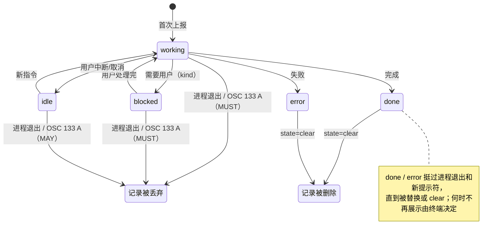
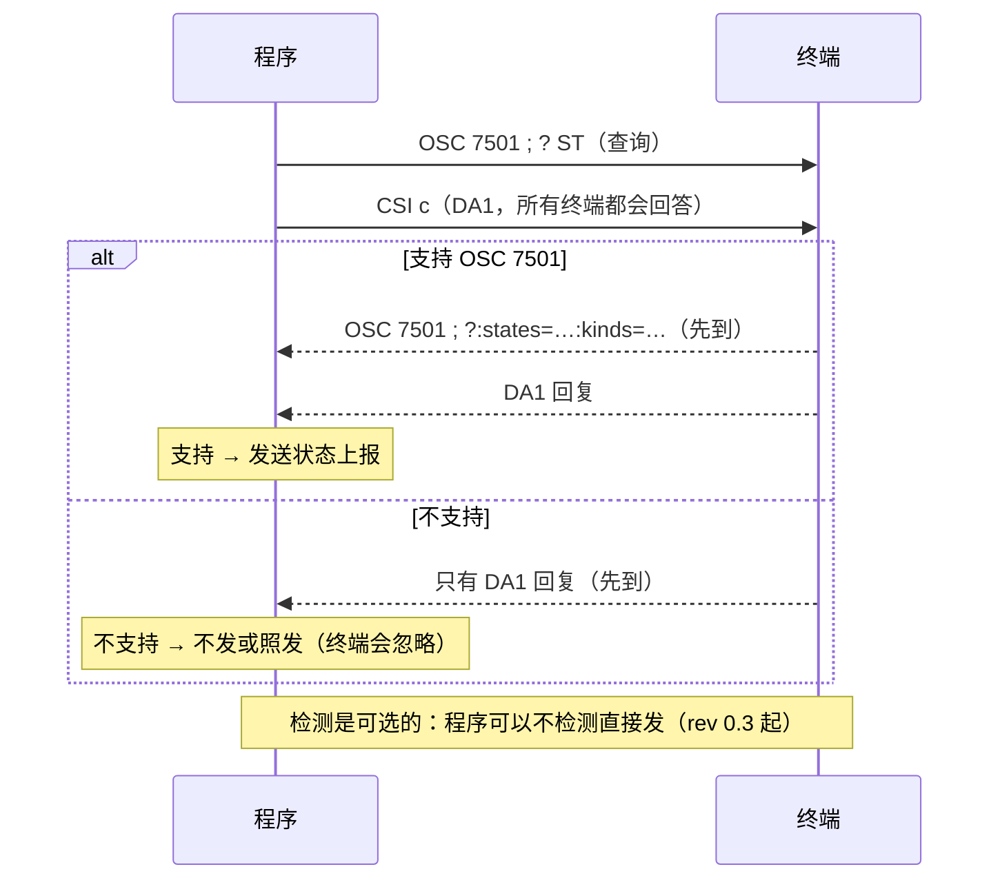

# OSC 7501 深度解读（核心）

本文是本仓库的**核心**部分：只讲协议本身——是什么、解决什么问题、字节格式与
语义、状态与记录模型、兼容检测与降级、安全边界、以及规范没说清的地方。生态
采纳与动机见 [why-integrate.md](why-integrate.md)，用法见 [practice.md](practice.md)。
本文以规范 rev 0.4（2026-10-10）文本为准；核实日期 2026-10-11
（Asia/Shanghai，CST）。

- 规范正文：<https://www.superlogical.com/rex/docs/build/program-status>
- 初稿 gist：<https://gist.github.com/mitchellh/7acae3abd8355c1c00287d67e96c913a>
- 作者博文：<https://mitchellh.com/writing/program-status-osc7501>

## 1 是什么

**定义**：OSC 7501「Program Status Protocol」是一个终端转义序列协议：程序向
它的终端（严格说是 PTY）输出 `OSC 7501 ; key=value… ST` 形式的报告，声明自己
当前的状态（working / blocked / done / error / idle）；终端或任何嵌在中间的
VT 解析库解析后按自己的方式呈现（标签、侧栏、通知、统一 inbox、手机……）。
协议由 Mitchell Hashimoto 发起，源于其在 Superlogical/Rex 上的工作。

### 规范示例逐字节拆解

最简示例的分段图见 [README · 30 秒看懂](../README.md#30-秒看懂)：


规范用一条 Terraform 报告作示例：

```text
ESC ] 7501 ; state=blocked:kind=permission:app=terraform:msg=QXBwbHkgMyB0byBhZGQsIDEgdG8gY2hhbmdlLCAwIHRvIGRlc3Ryb3k/ ESC \
```

十六进制（可用 `sh examples/bytes-demo.sh` 复现，见
[examples/RUNLOG.md](../examples/RUNLOG.md)）：

| 字节（hex） | ASCII | 含义 |
| --- | --- | --- |
| `1b 5d` | `ESC ]` | OSC 引入符（ESC = 0x1B，`]` = 0x5D） |
| `37 35 30 31` | `7501` | OSC 编号（ASCII 数字） |
| `3b` | `;` | 编号与数据分界 |
| `73 74 61 74 65 3d 62 6c 6f 63 6b 65 64` | `state=blocked` | 必填：状态 |
| `3a` | `:` | 键值对分隔符 |
| `6b 69 6e 64 3d 70 65 72 6d 69 73 73 69 6f 6e` | `kind=permission` | 仅 blocked：阻塞类型 |
| `3a` | `:` | 键值对分隔符 |
| `61 70 70 3d 74 65 72 72 61 66 6f 72 6d` | `app=terraform` | 报告者标识 |
| `3a` | `:` | 键值对分隔符 |
| `6d 73 67 3d` + 56 字节 base64 | `msg=QXBwbHkg…b3k/` | base64("Apply 3 to add, 1 to change, 0 to destroy?") |
| `1b 5c` | `ESC \` | ST（String Terminator） |

### 查询序列

特性检测用的是同一引入符、数据部分换成 `?`：

| 形式 | 字节 |
| --- | --- |
| ST 结尾 | `1b 5d 37 35 30 31 3b 3f 1b 5c` |
| BEL 结尾 | `1b 5d 37 35 30 31 3b 3f 07` |

rev 0.4 的回复规则：支持的终端必须回复以 `?` 开头的应答，之后**可选**跟
`:states=<逗号列表>` 与 `:kinds=<逗号列表>`，列出它接受的值；回复不带
`states` 就是恰好支持 idle、working、done、blocked、error，不带 `kinds` 就是
恰好支持 permission、question、auth——这两组**固定不变**（规范承诺以后版本
也不改）。想用后续版本新增 state 的程序先查列表，没有就回退到列表里有的
state；回复里不认识的键值对必须忽略。规范**不要求**回复复用请求的终止符；
参考实现 Ghostty 复用了请求的终止符（ST 请求回 ST、BEL 请求回 BEL）——那是
实现行为，不是规范要求。Ghostty 回复的实际字节（[PR #14630](https://github.com/ghostty-org/ghostty/pull/14630)
的测试断言）：

```text
ESC ] 7501 ; ?:states=idle,working,done,blocked,error:kinds=permission,question,auth ESC \
```

### 语法（规范原文 EBNF）

```ebnf
OSC 7501 ; pairs ST        report
OSC 7501 ; ? ST            feature detection
reply    := "?" (":" pair)*   feature detection reply (rev 0.4 正文；规范只给示例)
pairs    := pair (":" pair)*
pair     := key "=" value
key      := [a-z]+
value    := [A-Za-z0-9_.,+/=-]*
id       := segment ("/" segment)*
segment  := [A-Za-z0-9_.+-]{1,32}
```

解析规则（规范原文）：

- 键值对用 `:` 分隔；值字符集不含 `:` 与 `;`，因此**无需转义**；键/值两侧空白去掉。
- 畸形 pair（无 `=`、空 key、值含集合外字节）**跳过该 pair，其余继续处理**。
- 未知 key **必须忽略**（这就是扩展机制）；重复 key **后者生效**。
- `msg`/`title` 是 UTF-8 文本的标准 base64（padding 可选）；解码后不得含控制字符
  （U+0000–U+001F、U+007F、U+0080–U+009F，**含换行与 tab**）。rev 0.4 补了
  理由：这两个值是单行值，会展示在网格之外（标签标题、桌面通知、其他程序），
  单行纯文本便于换行与标签动画。
- 超限、base64 解码失败、解码含控制字符 → **整条报告丢弃**。
- `state` 必填；缺失或未知 state → **整条忽略**。

### 状态表（含生命周期）

| state | 语义 | 专属可选键 | 终端侧生命周期 |
| --- | --- | --- | --- |
| `idle` | 空闲 / 已取消 | — | 直到被替换或清除；进程退出/新提示符时可丢弃（MAY） |
| `working` | 正在工作中 | `progress` | 进程退出或新 shell 提示（OSC 133 A）时**必须丢弃** |
| `blocked` | 等待外部输入（授权、提问、登录） | `kind`、`progress` | 同上，**必须丢弃** |
| `done` | 成功完成 | — | 保留 |
| `error` | 失败 | — | 保留 |
| `clear` | 删除记录 | `id` | 立即删除该 id 及其所有子记录；无 id 清空全部 |



> **图注：** 这不是严格的状态机。每次上报都**整条替换**该 id 的记录，任何状态都可以
> 直接换成任何其他状态（包括首次上报就是 done/blocked 等）；图里只画了常见路径和规范
> 规定的丢弃规则。`clear` 不是状态：它删除指定 id 及其所有子记录，不带 id 时清空该终端
> 全部记录，对任何状态都适用。用户中断或取消时程序应报 `idle`；即将退出的程序 SHOULD
> 在退出前报 `done` 或 `error`，好留下记录给用户看。

协议**无心跳**：终端不得要求程序重发保活；状态是快照而非事件流。

### 键表

| 键 | 约束 | 说明 |
| --- | --- | --- |
| `state` | 必填，六值枚举 | 见上表；未知值整条忽略 |
| `id` | 缺省 = 根记录；总长 128、每段 32、最深 8 层 | 层级路径 `a/b/c`；不合语法整条忽略 |
| `kind` | 仅 blocked：`permission` / `question` / `auth` | 阻塞原因分类 |
| `progress` | 仅 working/blocked：0–100 整数 | 缺省 = 不确定进度 |
| `app` | `[A-Za-z0-9_.+-]{1,32}` | 程序标识：分组/过滤/图标用的键，不是标签（title 才是标签）；子记录从最近祖先继承 |
| `title` | base64，编码 256 / 解码 192 字节 | 展示标题 |
| `msg` | base64，编码 2732 / 解码 2048 字节 | 展示消息 |

### 记录模型

- **完整替换**：每条报告完整替换其 id 的记录——报告里没有的键，记录里也就没有
  了。所以每条报告都要重复 `app` 等想保留的键。
- **层级 id**：`id=a/b/c` 表示树；`clear` 带 id 时递归删除该子树，不带 id 时清空
  该终端的全部记录。
- **app 继承**：子记录的 `app` 从最近祖先继承（父记录写了 `app`，子报告可省略）。
- **复位行为**：RIS（全复位）清除所有记录（Ghostty 的实现是向嵌入方上报一次全
  清）；DECSTR（软复位）不清记录；主/备用屏切换无影响。
- **容量**：每终端记录上限 256（终端可设更低，但至少支持 64），超出时淘汰最久
  未更新的。

### 限制表

| 项 | 上限 |
| --- | --- |
| 整条序列 | 4096 字节 |
| key | 16 字节 |
| msg | 编码 2732 / 解码 2048 字节 |
| title | 编码 256 / 解码 192 字节 |
| app | 32 字节 |
| id | 总 128 字节、每段 32、最深 8 层 |
| 记录数 / 终端 | 上限 256（终端可设更低，但至少支持 64），LRU 淘汰 |

### rev 0.4 变化

修订起因是 kitty 作者的公开审阅（[kitty #10638](https://github.com/kovidgoyal/kitty/issues/10638)）。
Limits、状态集合、生命周期在 0.4 中均未变。

| 项目 | 0.3 | 0.4 |
| --- | --- | --- |
| 检测回复 | 必须回同样的 `?`；「未来版本可能加 pairs」 | 必须回 `?`，可选跟 `states=` / `kinds=` 列表 |
| 缺省语义 | 未定义 | 不带列表 = 恰好五 state、三 kind，固定不变 |
| terminfo | 终端 SHOULD 加 `Pst` 能力 | 整节删除 |
| 控制字符 | 只列范围 | 明确含换行/tab；理由：两值是单行值 |
| `app` | 机器可读的程序名 | 标识符（分组/过滤/图标用），不是标签；title 才是标签 |

## 2 要解决什么问题（元）

### 问题陈述

终端是黑盒：程序在里面跑，终端不知道它是在干活、在等输入、还是已经结束。
对 AI coding agent 尤其致命——会话动辄几十分钟，用户切走再回来，只能靠猜或
读屏。作者的[发布推文](https://x.com/mitchellh/status/2107577887159386152)给出
了三个数字：**250+** 个 agent 编排器各自用启发式检测 Claude Code 状态；Herdr
在 **3 个月**里做了约 **10 次**兼容改动；专有带外 API 是 **O(N)** 集成问题且
跨 SSH/容器要额外工作。

### 为何现有序列不够

| 序列 | 现有能力 | 缺什么 |
| --- | --- | --- |
| OSC 9;4（进度） | 忙/百分比/错误 | 只能表达进度；与 iTerm2 的 OSC 9 通知撞号 |
| OSC 9 / 99 / 777（通知） | 一次性 toast | 是事件不是状态：没有「当前状态」，错过即丢 |
| OSC 133（shell integration） | 提示符/命令边界 | 由 shell 发，不是任意程序发；无状态语义 |
| OSC 0 / 2（标题） | 任意文本 | 无结构、无状态语义，且是纯呈现指令 |
| OSC 21337（iTerm2 session status） | 会话状态 | 作者认为它描述呈现 |
| OSC 9999（Orca） | 程序状态 | 作者认为依赖 JSON、方向不对 |

规范同时规定了与 OSC 9;4 的共存规则：终端**可以**把 9;4 映射到根记录，但一旦
收到 7501 报告就 SHOULD 停止映射（避免双写）。

### 设计原则逐条解释与取舍

1. **为什么 base64**：值字符集 `[A-Za-z0-9_.,+/=-]` 不含 `:` 和 `;`，任意 UTF-8
   文本必须编码才能不破坏 pair 结构；标准 base64 的输出恰好全部落在值字符集内
   （`=` padding 可选）。附带的安全红利：解码后可以统一检查控制字符。
2. **为什么 `:` 分隔、值集不含 `:` `;`**：单遍、无状态机回溯的解析；畸形 pair
   只影响自己，不会让解析器失步。写错的程序最坏情况是丢一条报告，而不是弄脏
   整个终端状态。
3. **为什么无心跳**：作者在[回复](https://x.com/mitchellh/status/2107997330238795818)中
   明说：不想重复 OSC 9;4 需要 keep-alive 刷新的问题。代价是「陈旧记录」要靠
   生命周期规则（进程退出、OSC 133 A）兜底，这也是当前实践中暴露问题最多的
   地方（见 §5 反）。
4. **为什么未知 state 整条忽略**：state 是记录的锚点，未知 state 意味着接收端
   无法对这条记录建模；静默忽略比猜测安全。与之对照，**未知 key 忽略**才是
   前向兼容的扩展机制——未来加新键，旧终端不丢整条。
5. **为什么只回检测应答**：终端对程序的全部回写只有检测回复，内容以 `?`
   开头、可选带 states/kinds 列表，不含任何来自报告的字节——把注入攻击面
   压到零。
6. **终端原生、呈现无关**：字节流顺着 PTY 走，SSH、容器、多路复用器都天然在
   路径上；协议只描述「程序处于什么状态」，从不描述「该怎么画」。
7. **零依赖可实现**：博文里的 shell 函数一行 `printf` 即为完整发送端（见 §3）；
   接收端一个函数也能解析个八九不离十——刻意压低集成成本以换取采纳。
8. **检测可选**：rev 0.3 起明确可以不检测直接发送（未知 OSC 会被忽略，天然
   降级）；检测的价值在于体验（例如应用据此隐藏自己的 spinner）。

## 3 怎么实现（核心机制）

### 发送端最小实现

博文同款 shell 函数（POSIX sh，零依赖）：

```sh
status() {
  printf '\e]7501;state=%s:msg=%s\e\\' "$1" "$(printf '%s' "$2" | base64 | tr -d '\n')"
}
status working "compiling…"
```

本仓库把它扩展成带校验与 tmux 透传的函数库
[examples/osc7501.sh](../examples/osc7501.sh)（`osc7501_report` / `osc7501_status` /
`osc7501_clear`），以及命令包装器 [examples/wrap.sh](../examples/wrap.sh)。

一个「大号」发送端的样本是 pi（coding agent）的
[program-status.ts](https://github.com/earendil-works/pi/blob/v1.1.0/packages/tui/src/program-status.ts)，
其工程化细节值得抄：

- **只在终端应答支持查询后才发送**（文档同时写明 tmux 与 screen 不转发）；
- 只用根记录（不发层级 id）；
- 发送前把控制字符替换为空格、`msg` 截到 2048 字节——即「先校验后写入」；
- 环境变量强制开关（`PI_PROGRAM_STATUS=1/0`）便于调试；
- 报告不含 prompt 与模型输出（最小化信息暴露）。

### 接收端最小实现

本仓库 [examples/osc7501_parser.py](../examples/osc7501_parser.py) 是带完整校验的
增量解析器 + 记录存储（39 个单测全过，见
[examples/RUNLOG.md](../examples/RUNLOG.md)）：可跨 chunk 边界 feed；实现畸形
pair 跳过、未知 key 忽略、重复 key 后者生效、base64/控制字符/限长校验、整条
替换、clear 子树、app 祖先继承、进程退出/提示符清理 working/blocked、超 256 条
LRU 淘汰、RIS 全清。

参考实现是作者本人提交的 [Ghostty PR #14560](https://github.com/ghostty-org/ghostty/pull/14560)
（libghostty-vt，已合并未发版），关键路径：

- [program_status.zig](https://github.com/ghostty-org/ghostty/blob/main/src/terminal/osc/parsers/program_status.zig)：
  731 行规范级解析器；`max_sequence_bytes=4096`，body 上限 = 4096 −
  `len("\x1b]7501;")` − `len("\x1b\\")`——按较长的 ST 终止符预留，因此 BEL 结尾
  的序列少 1 字节余量；带大量 `test "OSC 7501: …"` 边界用例。
- [stream_terminal.zig](https://github.com/ghostty-org/ghostty/blob/main/src/terminal/stream_terminal.zig)
  的 `fn programStatus`：`.query => if (self.effects.program_status != null)
  writePty(…)`——**只有宿主设置了 program status effect 才回答查询**；rev 0.4
  起回复正文为 `query_reply`（`?` + states/kinds 列表，由 State/Kind 枚举在
  编译期生成），终止符与请求相同。
- [ghostty/vt C API](https://github.com/ghostty-org/ghostty/blob/main/include/ghostty/vt/terminal.h)：
  `GHOSTTY_TERMINAL_OPT_PROGRAM_STATUS` 选项 + `GhosttyProgramStatusState` 枚举
  （IDLE=0 … CLEAR=5），嵌入方每 id 保存一条记录并执行生命周期。
- **rev 0.4 跟进**：[PR #14630](https://github.com/ghostty-org/ghostty/pull/14630)
  （合并 2026-10-11 03:44 CST）把 libghostty-vt main 更新到 0.4，唯一的行为
  变化就是查询回复列出 states/kinds；仍未发版（最新 tag v1.3.1 不含）。Ghostty
  应用本身目前**忽略**这些报告（`stream_handler.zig` 中
  `.program_status => {}`）——库先行、应用后至的策略；PR #14560 原文还注明
  RIS 时上报一次全清，以及「OSC7501 是 Ghostty 项目首个原创的终端规范」。

### 兼容检测与降级



1. **查询 + DA1 竞态**：程序发 `OSC 7501 ; ? ST` 后紧跟 DA1（`CSI c` =
   `1b 5b 63`）。DA1 是几乎所有终端都必答的；**DA1 回复先到 ⇒ 不支持**。注意
   这对中间层有时序要求：[termio #713](https://github.com/termio-sh/termio/pull/713)
   专门让 termiod 在读路径上**先于 DA1** 回答 7501 查询，因为 Claude Code 和 pi
   都是查询与 DA1 一起发、DA1 一到就判负。
2. **检测可选**：rev 0.3 起明确可不检测直接发送；不支持 7501 的终端会忽略未知
   OSC，最坏情况等于什么都没发生。
3. **能力协商（rev 0.4）**：查询回复可在 `?` 后带 `states=` / `kinds=` 支持
   列表；不带即等于固定的五 state、三 kind（规范承诺以后版本也不变）。想用
   后续版本新增 state 的程序先查列表，没有就回退到列表里有的 state；回复里
   不认识的键值对必须忽略。
4. **tmux 透传（实测）**：tmux 不识别 7501，裸序列被丢弃；需要 DCS passthrough
   （`ESC P tmux; <内部 ESC 加倍的序列> ESC \`）且开启
   `set -g allow-passthrough on`。本仓库在 tmux 3.5a 上四象限实测确认，脚本与
   结果见 [examples/tmux-passthrough.sh](../examples/tmux-passthrough.sh) 与
   [examples/RUNLOG.md](../examples/RUNLOG.md)。
5. **OSC 9;4 并发**： Hugo 与 Composer 的 PR 都同时支持 9;4 与 7501；接收端按
   规范把 9;4 映射到根记录、收到 7501 后停止映射即可。
6. **体验建议**：作者建议检测到 7501 支持时，应用应隐藏自己在标题栏画的
   spinner（与 Rex 的 spinner 冲突）（[推文](https://x.com/mitchellh/status/2107681182649667671)）。

## 4 安全边界

规范的安全要求逐条解释：

| 要求 | 为什么 |
| --- | --- |
| `msg`/`title` 解码后含控制字符必须拒收、不得当标记解析 | 防止把转义/控制字节当指令执行（注入）；base64 解码是统一检查点 |
| 界面外展示 SHOULD 解除 bidi 方向覆盖等不可见格式字符 | 防止 RLO 等不可见字符在通知、侧栏等新上下文里重构显示语义（欺骗） |
| 终端唯一回写是检测回复，且不含任何来自报告的内容 | 程序无法借 7501 让终端写任意字节（回显攻击面为零） |
| 展示 SHOULD 标明状态来自哪个终端/会话 | 防冒充：任何程序都能发 `app=…`，标注来源让用户可归因 |
| 外部效果（通知/声音）SHOULD 限速 | `blocked` 若被滥用可变成通知轰炸 |
| 4096 字节整条上限 + 各字段限长 + 记录数上限 | 防资源耗尽；接收端可以放心按上限预分配 |

实现注意（本仓库实践归纳）：

- **先校验后写入**：长度、字符集、base64、控制字符全部检查通过后再动记录存储
  （pi 的做法：控制字符替换为空格、msg 截断到 2048；我们的解析器：任一项不过
  就整条丢弃）。
- 展示层把 `msg` 当**纯文本**渲染，不做任何标记解释。
- 检测回复只写 `?` 与自己的 states/kinds 列表，不要把报告内容回显回去。

## 5 时间 / 空间 / 变量 / 反 / 空

### 时间

阶段性叙述（完整带时间的表格见 [timeline.md](timeline.md)）：规范初稿以 gist
形式出现（9 月末）→ 博文与 rev 0.2 同日公开，作者同日向 Ghostty 提交
libghostty-vt 参考实现 PR，数小时后合并（未进入任何 Ghostty release）→ 次日
rev 0.3 → 24 小时内多家 agent/终端跟进（作者自述）→ 此后数日的集成潮（详见
时间线与支持矩阵）→ kitty 作者审阅并提出 5 点
（[#10638](https://github.com/kovidgoyal/kitty/issues/10638)）→ 作者逐条回复并
发布 rev 0.4（2026-10-10）→ Ghostty
[PR #14630](https://github.com/ghostty-org/ghostty/pull/14630) 跟进到 0.4
（2026-10-11 合并）。tmux 维护者同期表态观望。

### 空间（技术栈位置）

```text
[发送端]  agent / CLI / 任意长跑程序
    │  写 OSC 7501 到 stdout（或 /dev/tty）
    ▼
  PTY ──► ssh / 容器 / 多路复用器（tmux、zellij…）      ← 中间层：转发或丢弃
    ▼
[接收端]  终端（Rex、TUIOS、wietty…）
          或嵌入式 VT 库（libghostty-vt、SwiftTerm、xterm.dart…）
    │  解析 + 记录存储 + 生命周期 + 回答查询
    ▼
[呈现]  标签页标记 / 侧栏紧急度排序 / 系统通知 / 统一 inbox / 移动端
```

相邻协议：OSC 9;4（进度，可映射）、OSC 9/99/777（通知）、OSC 133（shell 集成，
提供丢弃 working/blocked 的提示符信号）、OSC 0/2（标题）、OSC 21337/9999（竞品）。

### 变量（决定行为的关键约束）

| 变量 | 取值 / 约定 | 影响 |
| --- | --- | --- |
| 编码 | pair `k=v`、`:` 分隔、msg/title 必须 base64 | 决定解析器复杂度与安全性 |
| 生命周期 | working/blocked 必须丢弃；done/error 保留；无心跳 | 陈旧记录风险 vs 刷新负担 |
| 记录模型 | 整条替换、层级 id、clear 递归、app 继承 | 决定接收端存储结构 |
| 检测 | 查询 + DA1 竞态；回复可列 states/kinds；检测可选 | 决定首包时序与降级行为 |
| 限制 | 4096/2048/192/128/32… | 决定资源上界 |
| 安全 | 控制字符、回写、来源标注、限速 | 决定实现的红线 |
| 透传 | 多路复用器需 DCS passthrough 等 | 决定 tmux 类环境可用性 |

### 反（反对、局限、失败模式）

- **tmux 维护者 nicm**：「This seems premature. Let's see if any other terminals
  and programs pick it up.」（[issue #5713](https://github.com/tmux/tmux/issues/5713)）
- **Herdr**：issue 被以 bugs-only 策略关闭、外部 PR 因贡献者政策被拒——流程性
  关闭而非技术否决（[#5069](https://github.com/herdrdev/herdr/issues/5069)、PR
  [#5093](https://github.com/herdrdev/herdr/pull/5093)）。
- **firebase-tools 重做**：两次实现被关闭，维护者计划以「fresh implementation」
  重做，关注点是从共享 chokepoint 推导状态、修复终端检测——说明「每个调用点
  手工包裹」的接入方式难维护（[#11245](https://github.com/firebase/firebase-tools/pull/11245)）。
- **陈旧记录**：Bubble Tea [#1845](https://github.com/charmbracelet/bubbletea/pull/1845)
  （open）修复程序退出/挂起后记录不消失的问题；para-code
  [#324](https://github.com/MocA-Love/para-code/pull/324)（已合并）在 Ctrl+Z 挂起
  期间暂停接收、fg 后重新打开。
- **ssh 内 OOM 残留**：agent 被 OOM kill 后没有 OSC 133 A、远端 shell 无集成，
  blocked 记录会一直挂着
  （[指出](https://x.com/shahidcodes/status/2107995544065081475)）；作者回复是
  故意不做刷新/心跳
  （[回复](https://x.com/mitchellh/status/2107997330238795818)）——生命周期规则
  依赖 shell 集成，这条链在纯 SSH 远端是断的。
- **竞品序列**：iTerm2 OSC 21337、Orca OSC 9999 先于 7501 存在且语义重叠；作者
  认为它们「描述呈现」或「依赖 JSON」，方向不对，但市场未定。
- **利益相关**：规范源于 Superlogical/Rex 的工作（PR 原文自承）；Rex 目前似为
  beta 邀请制（推断：多名开发者在 X 上索要 Rex beta 邀请），早期验证多与 Rex
  绑定。规范文本本身无产品专属内容。
- **Ghostty 应用未展示**：参考实现已进 libghostty-vt，但 Ghostty 应用本身忽略
  报告（应用侧 `.program_status => {}`）。

### 空（规范未说清 / 生态缺失）

每条标注：〔规范缺口〕= 规范文本没写清；〔实践暴露〕= 已在真实集成里撞到。

1. 〔规范缺口〕多路复用器如何**按 pane** 保存记录并向外层终端上报（cmux 自行
   设计了 per-pane 存储与侧栏；tmux 无表态）。
2. 〔规范缺口〕**SSH 断开后**远端残留记录如何处理（与「ssh 内 OOM 残留」同根）。
3. 〔实践暴露〕**挂起（Ctrl+Z）** 的语义：挂起算不算「进程退出」？Bubble Tea
   #1845 与 para-code [#324](https://github.com/MocA-Love/para-code/pull/324)
   （已合并：挂起期间暂停接收、fg 后重新打开）都在补这个洞。
4. 〔规范缺口〕**多个程序共用一个 pty**（例如 wrapper 套 wrapper）时层级 id 的
   所有权与冲突。
5. 〔实践暴露〕**DA1 竞态对中间层的要求**：多路复用器/工作台必须先于 DA1 回答
   查询（termio #713 被迫自行约定；规范未提）。
6. 〔规范缺口〕**无一致性测试套件**：没有官方 compliance tests，各接收端行为
   是否一致无从检验（libghostty-vt 的 test 块是最接近的东西）。
7. 〔规范缺口〕`progress` 缺省「不确定」与 `idle` 的区分在不同 UI 上如何表达，
   规范不置可否（呈现无关的代价）。
8. 〔规范缺口〕`progress` 的数字格式：规范只说 0–100 整数，前导零（如 `040`）
   是否合法未写明；Ghostty 的 parseProgress 与本仓库解析器都接受 `040`=40
   （实测/读源码）。
9. 〔规范缺口〕**id 总长上限 128 与 8×32+7=263 不一致**：kitty 作者指出 8 层、
   每段 32 字节加 7 个分隔符应为 263，规范却写总长 128 且未解释；Ghostty 的
   `max_id_bytes` 仍为 128。截至 2026-10-11 未修
   （[kitty #10638 评论](https://github.com/kovidgoyal/kitty/issues/10638#issuecomment-6102046211)）。
10. 〔规范缺口〕**回复是否必须复用请求的终止符**（ST/BEL）未写明；参考实现
    Ghostty 复用请求的终止符（实现行为，非规范要求）。

这些空白就是贡献机会：测试套件、多路复用器参考行为、9;4→7501 迁移工具（见
[README 空白清单](../README.md#空白清单可贡献)）。
