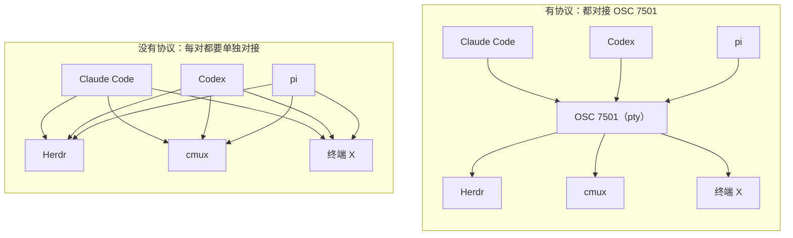

# 为什么要有 OSC 7501

核实日期：2026-10-11（CST）· 规范版本：rev 0.4（2026-10-10）。

本文回答「为什么要有这个协议」。事实取自已核实的一手材料（规范、博文、X、HN、GitHub）。
标签：**【观察】**= 有来源的事实；**【推断】**= 本仓库的判断；**【建议】**= 行动建议。
证据不足处标 **PARTIAL**。

## 一句话答案

程序自己最清楚自己在干活、在等你，还是做完了；OSC 7501 让它用一行 printf、走终端本来就有的 pty 把状态说出来，所有终端和工作台用同一种方式读，不用再猜屏幕。

## 痛点：没有它之前怎么做

先看一个场景。你同时开 5 个 agent。它们分别在 5 个标签或窗格里。其中一个在等你批准权限。你不知道是哪个。你只能逐个切过去看。

没有统一协议时，旧做法有五种。每条都是一句「怎么做」加一句「哪里不行」：

- **【观察】读屏 / 读标题（启发式）。** 工作台解析窗口标题、匹配屏幕内容，猜程序状态。规则脆弱：Herdr 为 Claude Code 写了 16 条检测规则，3 个月改了 10 次；作者发现 250+ 个 agent 编排器都在这么做。（[发布推文](https://x.com/mitchellh/status/2107577887159386152)、[博文](https://mitchellh.com/writing/program-status-osc7501)）
- **【观察】专有 API / socket / hooks。** 程序走 socket 或 hooks 自报状态，比读屏准。但每个程序要分别对接每个 inbox，本地 socket 过 SSH、容器还要额外桥接。作者原话："every program has to integrate with every inbox separately"、"The pty already works across all of this."；被问「只靠 hooks 行不行」时他回答："It's not possible to implement this spec with hooks alone."（[博文](https://mitchellh.com/writing/program-status-osc7501)、[X 问答](https://x.com/mitchellh/status/2108563196735078644)）
- **【观察】桌面通知（OSC 9 / 777 等）。** 程序在事件发生时发一条通知。通知是一次性事件，没有当前状态。（[规范 Motivation](https://www.superlogical.com/rex/docs/build/program-status)）
- **【观察】OSC 9;4 进度。** 程序上报忙 / 百分比 / 错误。它说不出「在等用户」和「在做什么」。（[规范 Motivation](https://www.superlogical.com/rex/docs/build/program-status)）
- **【推断】终端响铃。** 程序需要注意时响铃。只有一个信号「有事了」，分不清在等你、在干活还是做完了。HN 用户 Vegenoid："we already have the terminal bell … The total lack of mention of the terminal bell in the article is weird."（[HN](https://news.ycombinator.com/item?id=50013800)）

### 之前 vs 之后

| 维度 | 之前 | 之后（OSC 7501） |
| --- | --- | --- |
| 谁判断状态 | 工作台猜（读屏 / 读标题），或程序走专有通道自报 | 程序自己报，经 pty 带内送达 |
| 准确性 / 维护成本 | 启发式脆弱；Herdr 3 个月改 10 次（仅针对 Claude Code） | 状态是程序亲口说的；接收端只解析一种序列 |
| 能否区分「在等你」与「在干活」 | 不能：OSC 9;4 只有忙 / 百分比，响铃只有一个信号 | 能：`blocked` 与 `working` 是不同 state |
| 能否说明原因（msg/kind） | 不能 | 能：`kind` 区分 permission / question / auth，`msg` 说明原因 |
| 过 SSH / 容器 | 专有 socket 要额外桥接 | pty 字节流天然到达 |
| 多 agent / 子任务 | 每个程序对每个 inbox 单独对接 | 所有程序同一种序列；层级 `id` 可表达子 agent |
| 接入成本 | N 个程序 × M 个 inbox 各自对接 | 发送端一行 printf；接收端解析一种序列 |
| 展示方式 | 通知一次性弹出，或每家 inbox 自己发明 UI | 协议只共享状态，展示由终端自定 |

## 为什么是这种设计

- **【观察】带内转义序列。** 状态写在 OSC 转义序列里，走 pty 字节流。SSH、容器天然可用。不认识的终端必须忽略未知 OSC，所以盲发安全。规范原话："Properly behaved terminal emulators MUST already ignore unknown OSCs, so sending reports without detecting support is safe."（[规范](https://www.superlogical.com/rex/docs/build/program-status)）
- **【观察】只共享状态，不规定展示。** 规范原话："The protocol shares state and leaves presentation to the terminal. It does not say how anything is shown"。接收端可以做成 inbox、侧栏、标签标记；cmux 侧栏按紧急度 blocked > error > working > done 展示（[why-integrate.md](why-integrate.md)）。
- **【观察】选 OSC，不选 APC。** HN 用户 JdeBP 认为它更像 APC。mitchellh 回答：APC 支持更差，macOS Terminal.app 会把 APC 直接打印出来；OSC 有编号、可多路复用，定界明确，未知值被忽略。（[HN](https://news.ycombinator.com/item?id=50015442)、[回复](https://news.ycombinator.com/item?id=50015511)）
- **【观察】零依赖。** 博文原话："No SDK, no sockets, no environment variables, no JSON."。一个 POSIX sh 函数就能完成集成。（[博文](https://mitchellh.com/writing/program-status-osc7501)）

### 集成数量：N×M 还是 N+M



作者原话是 "O(N) integration problem"、"every program has to integrate with every inbox separately"（[发布推文](https://x.com/mitchellh/status/2107577887159386152)、[博文](https://mitchellh.com/writing/program-status-osc7501)）。「N×M 对 N+M」是本仓库的图示化转述（**【推断】**）。

## X 和社区上的声音

**【推断】** 支持面广、行动快；核心批评集中在规范成熟度、与现有方案重叠、tmux 观望。依据是下面三张表。时间均为 CST；互动量为 X API 在 2026-10-11 15:30 前后返回的值。

### 支持与已行动

| 作者 | 身份 | 原文短引 | 中文意译 | 时间（CST） | 互动 | 链接 |
| --- | --- | --- | --- | --- | --- | --- |
| @mitchellh（Mitchell Hashimoto） | 规范作者；X 简介：Superlogical 联合创始人、Ghostty 作者、HashiCorp 创始人 | "Incredible speed @AnthropicAI supporting this protocol which will help hundreds or thousands of downstream applications! They had access to Rex and verified through Rex it works." | Anthropic 支持得非常快，会帮到成百上千个下游应用；他们用 Rex 验证过可用。 | 10-09 04:40 | 赞 2169 · 浏览 161050 | <https://x.com/mitchellh/status/2108296550405619967> |
| @mitchellh | 同上 | "integrated in Amp, Factoryai, TUIOS, libghostty. Verbal support and in-progress PRs by Claude Code, cmux, Codex, Herdr, OpenCode, Pi …" | 24 小时内 Amp、Factory、TUIOS、libghostty 已集成；Claude Code、cmux、Codex、Herdr、OpenCode、Pi 口头支持或有进行中的 PR。 | 10-08 02:03 | 赞 976 · 浏览 38779 | <https://x.com/mitchellh/status/2107894687587795079> |
| @badlogicgames（Mario Zechner） | pi 作者（帖子自述） | "happy to announce that the next release of @pidotdev supports OSC 7501 … hoping for quick uptake by others." | pi 下一版支持 OSC 7501，希望其他工具尽快跟进。 | 10-08 03:49 | 赞 811 · 浏览 34437 | <https://x.com/badlogicgames/status/2107921299297177833> |
| @almonk | X 简介：Superlogical 联合创始人 | "48 hours to Claude Code support. ty @AnthropicAI" | 48 小时就拿到 Claude Code 的支持，感谢 Anthropic。 | 10-09 05:09 | 赞 772 · 浏览 62394 | <https://x.com/almonk/status/2108303705883992208> |
| @charmcli（Charm） | Bubble Tea / Crush 的公司官方号 | "Bubble Tea v2.1.0 now supports the hot new Program Status Protocol … Now your TUIs can tell the terminal what they're doing, and why." | Bubble Tea v2.1.0 已支持；用它写的 TUI 都能告诉终端自己在做什么、为什么。 | 10-10 02:41 | 赞 203 · 浏览 8666 | <https://x.com/charmcli/status/2108629047966109871> |
| @cancelik（Can.） | Herdr 开发者（X 简介：building @herdrdev；Herdr 正是博文里的启发式案例） | "fully agree, I was working on almost the exact same protocol … herdr will support it." | 完全同意，我也在做几乎一样的协议，很高兴你先做出来了，Herdr 会支持。 | 10-07 05:23 | 赞 173 · 浏览 7799 | <https://x.com/cancelik/status/2107582481243488762> |
| @agent_wrap | X 简介：member of technical staff @FactoryAI | "Protocol detection is already in place … Lots of possibilities with 7501. Notifications, subagent status, attention inbox..." | 检测已经做好了；7501 的可能性很多：通知、子 agent 状态、注意力收件箱。 | 10-07 12:10 | 赞 6 | <https://x.com/agent_wrap/status/2107684981770420225> |
| @ProgrammerDude（Arian van Putten） | X 简介：nixos witchcraft at mercury | "Uapi group would possibly be a good host for this standard … I am already cooking a PR to add it to Systemd" | UAPI group 可能适合托管这个标准；我已经在写给 systemd 加支持的 PR。 | 10-09 05:53 | 赞 42 | <https://x.com/ProgrammerDude/status/2108314951681020177> |
| @tuistdev（Tuist） | Tuist 官方号 | "the next version of the Tuist CLI will have support for it" | Tuist CLI 下一版会支持。 | 10-09 01:21 | 赞 11 | <https://x.com/tuistdev/status/2108246492288884763> |
| @alexjhancock（Alex Hancock） | X 简介：Software @Blocks | "I'll add support for @goose_oss and would love to be able to test it in Rex!" | 我会给 goose 加支持，想在 Rex 里测试。 | 10-09 05:28 | 赞 0 | <https://x.com/alexjhancock/status/2108308600770728277> |
| @MiguelriosEN（Miguel Ríos Berríos） | X 简介：Founder, CTO at @GrepDotAI | "My current gripe with herdr right now is “TLM” agents not effectively knowing when “engineers” are done with their task. They need to be constantly supervised." | 我现在的痛点是「组长」agent 不知道「工程师」agent 什么时候做完，得一直盯着。 | 10-08 22:55 | 赞 1 | <https://x.com/MiguelriosEN/status/2108209753759633612> |
| @dualface | X 简介：20+ 年开源，用一群 AI agent 做开发工具 | "Right now I detect agent session states via hooks + transcript parsing. Accuracy is acceptable, but the complexity is way too high." | 我现在用 hooks + 解析会话记录来判断 agent 状态，准确率还行，但太复杂了。 | 10-08 09:26 | 赞 0 | <https://x.com/dualface/status/2108006116898820455> |
| @gregkop（Greg Kopyltsov） | X 简介：founder | "which agent is waiting on me" is basically the whole game. a shared status spec means multiplexers can compete on UX instead of per-agent hacks | 「哪个 agent 在等我」基本就是全部问题；有了共享规范，多路复用器可以比拼体验，而不是给每个 agent 写补丁。 | 10-09 02:47 | 赞 0 | <https://x.com/gregkop/status/2108268179361337533> |

### 质疑与批评

| 作者 | 身份 | 原文短引 | 中文意译 | 时间（CST） | 链接 |
| --- | --- | --- | --- | --- | --- |
| kovidgoyal（GitHub） | kitty 作者 | "This proposal doesnt seem to be mature, was it discussed anywhere public?" | 这个提案似乎不成熟，有没有公开讨论过？另列 5 点：terminfo 无用；扩展性（查询回复应能报告支持的 state/kind 或带版本）；控制字符规则要说明原因；app 名为何限 ASCII、用途是什么；长度限制。 | 10-10 14:20 | <https://github.com/kovidgoyal/kitty/issues/10638> |
| mitchellh（回复） | 规范作者 | "All of the above is in the doc now as revision 0.4." | 删除 terminfo；查询回复可带 states=/kinds=；补充控制字符理由和 app 的用途；指出各字段已有单独上限。以上都已写进 rev 0.4。 | 10-11 02:58 | 同上 |
| kovidgoyal（再回复） | kitty 作者 | "When I look at implementing it I will probably discover more" | 对多数回答 OK / Thanks；指出 id 上限算术（32×8=256，不是 128）；base64 padding 要写清；实现时可能还会发现问题。 | 10-11 04:51 | 同上 |
| nicm（GitHub） | tmux 维护者 | "This seems premature. Let's see if any other terminals and programs pick it up." | 似乎过早，先看其他终端和程序会不会采纳。第二条：pane 标题、OSC 9 进度条和 OSC 133 眼下够用，先看它能不能火起来。 | 10-09 18:35 / 10-10 01:51 | <https://github.com/tmux/tmux/issues/5713> |
| @paaloeye（Paal Øye-Strømme） | X 简介：Dev Tools for post-Claude orgs bij Åndra Labs | "What if the spec is fundamentally flawed … I feel like they/we are blindly adopting something." | 担心大家在盲目采纳一个可能有根本缺陷的规范；HN 上认为规范太偏 TUI AI agent，建议扩展 UAPI.15 OSC 3008（systemd 已实现）。 | 10-08 23:50（X） | <https://x.com/paaloeye/status/2108223526679216473> · <https://news.ycombinator.com/item?id=50007229> · <https://news.ycombinator.com/item?id=50015912> |
| kevin_thibedeau（HN） | 身份未知 | "Piling on more in-band signaling is just going to become a security nightmare. It would be better to have a safe way to query process state that can be locked down as needed." | 继续堆带内信令会成为安全噩梦；更好的是一种可以锁定的安全查询进程状态的方式。 | 10-09 04:57 | <https://news.ycombinator.com/item?id=50012157> |
| JdeBP（HN） | 身份未知 | —（观点转述） | 认为它不是真正的 OSC，而是 APC。mitchellh 回复：APC 支持更差（macOS Terminal.app 会把 APC 直接打印出来），OSC 有编号多路复用和明确定界，未知值会被忽略。 | 10-09 10:56 / 11:07 | <https://news.ycombinator.com/item?id=50015442> · <https://news.ycombinator.com/item?id=50015511> |
| Vegenoid（HN） | 身份未知 | "we already have the terminal bell … The total lack of mention of the terminal bell in the article is weird." | 已经有终端响铃了，文章完全没提响铃很奇怪。 | 10-09 07:19 | <https://news.ycombinator.com/item?id=50013800> |

> **kitty 一组的结果**：kitty 作者 10-10 审阅并提出 5 点。作者 10-11 逐条回复并发布 rev 0.4：删除 terminfo `Pst`，查询回复可带 `states=` / `kinds=`（规范 Revision history，起因即这次审阅）。kitty 作者随后回 "OK, I can live with that."，接受删除 terminfo、能力协商、控制字符与 app 的回答；同时指出 id 上限算术应为 8×32+7=263 而非 128，截至 2026-10-11 规范与 Ghostty 均未改（[评论](https://github.com/kovidgoyal/kitty/issues/10638#issuecomment-6102046211)）。issue 已于 2026-10-13 11:58 关闭：master 已实现，id 上限用 263（见 [research/2026-10-21.md](../research/2026-10-21.md)）。

### 观望与边界问题

| 作者 | 身份 | 原文短引 | 中文意译 | 时间（CST） | 链接 |
| --- | --- | --- | --- | --- | --- |
| @vmramirez85 + @mitchellh | ML/Data Engineer（简介）；规范作者 | "It's not possible to implement this spec with hooks alone." | 问：Claude Code 里用 hooks 不也能得到类似行为，这个规范的好处是什么？答：只靠 hooks 实现不了这个规范。 | 10-09 22:11 / 22:20 | <https://x.com/vmramirez85/status/2108560916233048099> · <https://x.com/mitchellh/status/2108563196735078644> |
| @shahidcodes + @mitchellh | —；规范作者 | "Yes this is on purpose. The need for OSC 9;4 to refresh is not something I wanted to repeat." | 问：ssh 里 agent 被 OOM 杀掉、远端 shell 不发 OSC 133 A，blocked 记录会一直挂着？答：设计上故意不做刷新 / 心跳，不想重复 OSC 9;4 要刷新的老路。 | 10-08 08:44 / 08:51 | <https://x.com/shahidcodes/status/2107995544065081475> · <https://x.com/mitchellh/status/2107997330238795818> |
| @mitchellh（回复 @ProgrammerDude） | 规范作者 | "I like the idea of an independent group owning it." | 我喜欢由独立组织来托管它的想法。 | 10-09 06:01 | <https://x.com/mitchellh/status/2108316851537322111> |
| @ChristopheLams | X 简介：AI innovation architect | "Is there a plan to version the spec early, before every integration bakes in a slightly different interpretation?" | 会不会尽早给规范加版本，免得每个集成理解略有不同？ | 10-08 16:20 | <https://x.com/ChristopheLams/status/2108110346619904158> |
| @zhi5141 | 无可核实身份 | —（观点转述） | tmux 不透传，多开 agent 的主流姿势暂时用不上；协议报的是程序状态，不是任务语义（进程结束不等于任务成功）。 | 10-09 23:28 | <https://x.com/zhi5141/status/2108580319033250282> |
| @asmirkn | — | "one tab with five agents inside still shows as just working" | 一个标签里 5 个 agent 仍只显示 working（注：规范已有层级 id，可表达子 agent）。 | 10-09 05:39 | <https://x.com/asmirkn/status/2108311377580298615> |
| @shipwithai11 | 小号，身份不详 | —（实测转述） | 实测：tmux 吞掉不认识的序列；用 pipe-pane + awk 解码后写到 pane 标题。 | 10-09 20:32 | <https://x.com/shipwithai11/status/2108536117473468436> |

### 没找到（PARTIAL）

- Anthropic 员工（如 @bcherny）、Amp/Sourcegraph（@sqs、@thorstenball）、Factory 创始人、WezTerm 作者、iTerm2 作者、Vercel、Docker 在 X 上关于 7501 的公开评论：本次搜索未找到。唯一来自 Factory 的是 @agent_wrap（简介：member of technical staff @FactoryAI）。
- @_can1357 的唯一相关帖是 tern / omp 版本预告，无评价性内容。
- 搜索结果受 X API 相关性排序与每页 25 条限制，不是全量（PARTIAL）。

## 现实意义

### 用 agent 的人

- **【观察】** 同时开多个 agent 时，终端 / 工作台可以直接显示「哪个在等你」（`blocked` + `kind`），不用来回切标签。（[博文](https://mitchellh.com/writing/program-status-osc7501) agentic inbox 段）
- **【观察】** Rex 已落地这种展示：未聚焦标签头与会话选择器标记完成或阻塞（[规范 In Rex 段](https://www.superlogical.com/rex/docs/build/program-status)）。
- **【观察】** @shipwithai11 自述："Eleven tab switches on yesterday's longest agent run, two today"（个人自述）。意译：昨天最长的一次 agent 运行切了 11 次标签，今天只切 2 次。

### agent 开发者

- **【观察】** 一个 printf 就能接入所有支持的终端，不用给每个 inbox 写插件。（[博文](https://mitchellh.com/writing/program-status-osc7501)：POSIX sh 函数）
- **【观察】** 已有实例：Claude Code v2.1.295、pi v1.1.0 已发布；Codex 已随 [rust-v0.163.0](https://github.com/openai/codex/releases/tag/rust-v0.163.0) 发布（2026-10-16 05:30 CST）；opencode 经 [anomalyco/opencode#55172](https://github.com/anomalyco/opencode/pull/55172) 合并（2026-10-14 04:48 CST，经 OpenTUI 0.6.3 `setProgramStatus`，是否已随 release 发出未确认）。（[support-matrix.md](support-matrix.md)，2026-10-21 核实）
- **【观察】** 库层已发布：Bubble Tea v2.1.0、SwiftTerm v1.99.0 等；用库的程序直接获得发送能力（[support-matrix.md](support-matrix.md)）。

### 终端与工作台开发者

- **【观察】** 不用再维护读屏正则：Herdr 的 Claude Code 检测 3 个月改 10 次。（[博文](https://mitchellh.com/writing/program-status-osc7501)）
- **【观察】** 可以把精力放在 UX 上："a shared status spec means multiplexers can compete on UX instead of per-agent hacks"（[@gregkop](https://x.com/gregkop/status/2108268179361337533)）。

### 非 AI 工具

- **【观察】** 问题不限于 AI：构建、部署、包升级、数据处理同样适用（Homebrew、Terraform、Cargo 等，[博文](https://mitchellh.com/writing/program-status-osc7501)）；tuist 用 `blocked kind=auth` 报浏览器登录等待；Hugo 已随 v0.168.0 发布，Composer 有进行中的 PR。
- **【观察】PARTIAL** systemd 支持仅为 @ProgrammerDude 自述（「已经在写 PR」），PR 是否存在未核实。

## 未来前景

本节整体为**【推断】**。

可能走向：

1. **成为事实标准。** 依据：发送端与接收端在首日到首周密集落地，多家已发布（见 [support-matrix.md](support-matrix.md)）。
2. **停留在 agent 工作台圈子。** 依据：主流终端（WezTerm、iTerm2、Windows Terminal、Alacritty、zellij）未见实现；kitty 仅 master 实现未发版；tmux 观望后关闭 issue（2026-10-13，无上游提交）。
3. **被并入或对齐其他标准（如 UAPI、OSC 3008）。** 依据：UAPI 托管建议与作者「independent group」表态；OSC 3008 扩展建议。

风险：

- 只有少数终端展示时，发送端收益有限（先有鸡还是先有蛋）。
- 带内信令的安全顾虑（[HN](https://news.ycombinator.com/item?id=50012157)）。
- 与 OSC 3008、OSC 9;4、响铃的重叠之争。
- 规范仍在快速变化，早期实现可能按旧版写（例如按 rev 0.3 要求的 terminfo `Pst`；rev 0.4 已整节删除）。

### 可观察信号

| 信号 | 现在的状态（链接，日期） | 怎么看 |
| --- | --- | --- |
| kitty 是否出现实现提交 | 已出现：master merge 0e1b7f4812（2026-10-13 10:59，id 上限 263）；#10638 已关闭，最新 release v0.49.2 不含（[research/2026-10-21.md](../research/2026-10-21.md)） | 主流终端的第一家；进入 release 即强信号 |
| WezTerm / iTerm2 / Windows Terminal 是否开 issue / PR | 未见实现（代码搜索，2026-10-09） | 每新增一家，发送端收益扩大 |
| tmux 维护者立场 | nicm：premature；现有 pane 标题 + OSC 9 + OSC 133 够用（[tmux#5713](https://github.com/tmux/tmux/issues/5713)，2026-10-09 / 10；issue 2026-10-13 关闭、无上游提交） | 立场改变前，tmux 用户要用 DCS passthrough + `allow-passthrough on` |
| Ghostty 应用是否在 release 里展示记录 | 未支持；最新 tag v1.3.1，libghostty-vt 已合并（2026-10-11） | 某个 release 展示记录，即「作者自家终端」落地 |
| 标准化去处 | UAPI 托管建议 + 作者："I like the idea of an independent group owning it."（[X](https://x.com/mitchellh/status/2108316851537322111)，2026-10-09） | 迁到独立组织 / 仓库、出现版本号与兼容性测试，即走向标准 |
| 规范变化速度 | rev 0.1→0.4 共 12 天（2026-09-28 → 10-10）；rev 0.4 删 terminfo、加能力协商 | 快速变化是活力也是风险：盯紧 Revision history，别按旧版实现 |

## 对多 agent 工程团队的启示

以下均为**【建议】**，面向同时管理多个 agent 的工程团队（例如物流类 AI 平台团队）。

### 现在就能用

- 发送端用已支持的程序：Claude Code ≥ v2.1.295、pi ≥ v1.1.0、Codex ≥ rust-v0.163.0；opencode main 已合并（[anomalyco/opencode#55172](https://github.com/anomalyco/opencode/pull/55172)，是否已随 release 发出未确认）。
- 接收端用已支持的工作台：termio v0.56.0、TUIOS v0.9.0、cmux 主分支等（见 [support-matrix.md](support-matrix.md)）。
- 在 tmux 里：需要 DCS passthrough 并开 `allow-passthrough`；或参照 @shipwithai11 的 pipe-pane + awk 做法（未验证）。

### 在自己的系统里怎么用

- 给长任务（批处理、数据同步、部署脚本）加一行 printf：开始报 `working`，结束报 `done` 或 `error`，需要人工审批时报 `blocked kind=permission`。
- 物流场景（**【推断】**）：路径规划批任务、对账任务、等待人工确认的调度变更，都适合上报。
- 平台若有内置终端 / Web 终端（xterm.js 系），可以解析 7501 做「待你处理」收件箱；参考 [examples/osc7501_parser.py](../examples/osc7501_parser.py)。

```sh
# app=recon 换成你的任务名
printf '\033]7501;state=working:app=recon\033\\'
printf '\033]7501;state=blocked:kind=permission:app=recon\033\\'
printf '\033]7501;state=done:app=recon\033\\'
printf '\033]7501;state=error:app=recon\033\\'
```

### 可以贡献什么

- 一致性测试套件。
- tmux 侧方案。
- xterm.js 实现（目前未见）。
- 中文用户的实践文档。
- 向 wezterm 的 issue 提供真实用例数据（kitty 已在 master 实现）。

## 来源

- 规范（rev 0.4，2026-10-10）：<https://www.superlogical.com/rex/docs/build/program-status>
- 博文 A Terminal Protocol for Program Status (OSC 7501)（2026-10-06）：<https://mitchellh.com/writing/program-status-osc7501>
- X：
  - [发布推文](https://x.com/mitchellh/status/2107577887159386152)（2026-10-07）
  - [24 小时集成汇总](https://x.com/mitchellh/status/2107894687587795079)
  - [Claude Code 支持推文](https://x.com/mitchellh/status/2108296550405619967)
  - [pi 支持公告](https://x.com/badlogicgames/status/2107921299297177833)
  - [48 小时 Claude Code 支持](https://x.com/almonk/status/2108303705883992208)
  - [Bubble Tea v2.1.0](https://x.com/charmcli/status/2108629047966109871)
  - [Herdr 将支持](https://x.com/cancelik/status/2107582481243488762)
  - [Factory：7501 的可能性](https://x.com/agent_wrap/status/2107684981770420225)
  - [UAPI 托管与 systemd PR](https://x.com/ProgrammerDude/status/2108314951681020177)
  - [Tuist 将支持](https://x.com/tuistdev/status/2108246492288884763)
  - [goose 支持计划](https://x.com/alexjhancock/status/2108308600770728277)
  - [Grep 的痛点](https://x.com/MiguelriosEN/status/2108209753759633612)
  - [hooks + 解析太复杂](https://x.com/dualface/status/2108006116898820455)
  - [共享规范与 UX 竞争](https://x.com/gregkop/status/2108268179361337533)
  - [规范可能有根本缺陷](https://x.com/paaloeye/status/2108223526679216473)
  - [hooks 问答](https://x.com/vmramirez85/status/2108560916233048099) · [作者回答](https://x.com/mitchellh/status/2108563196735078644)
  - [OOM 残留问答](https://x.com/shahidcodes/status/2107995544065081475) · [作者回答](https://x.com/mitchellh/status/2107997330238795818)
  - [独立组织托管](https://x.com/mitchellh/status/2108316851537322111)
  - [规范版本化提问](https://x.com/ChristopheLams/status/2108110346619904158)
  - [tmux 透传与任务语义](https://x.com/zhi5141/status/2108580319033250282)
  - [一个标签五个 agent](https://x.com/asmirkn/status/2108311377580298615)
  - [tmux 实测与 pipe-pane](https://x.com/shipwithai11/status/2108536117473468436)
- HN：
  - [主帖](https://news.ycombinator.com/item?id=49984159)（185 分，53 条评论，2026-10-07）
  - [OSC vs APC](https://news.ycombinator.com/item?id=50015442) · [作者回复](https://news.ycombinator.com/item?id=50015511)
  - [带内信令安全](https://news.ycombinator.com/item?id=50012157)
  - [终端响铃](https://news.ycombinator.com/item?id=50013800)
  - [OSC 3008 建议](https://news.ycombinator.com/item?id=50007229) · [同主题](https://news.ycombinator.com/item?id=50015912)
- GitHub：
  - [kitty#10638](https://github.com/kovidgoyal/kitty/issues/10638)
  - [tmux#5713](https://github.com/tmux/tmux/issues/5713)
  - [openai/codex#52725](https://github.com/openai/codex/pull/52725)
  - [anomalyco/opencode#54402](https://github.com/anomalyco/opencode/pull/54402)
